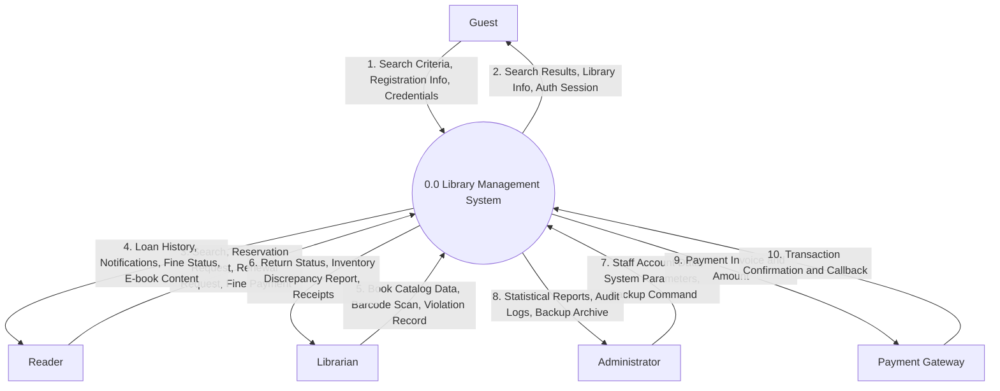
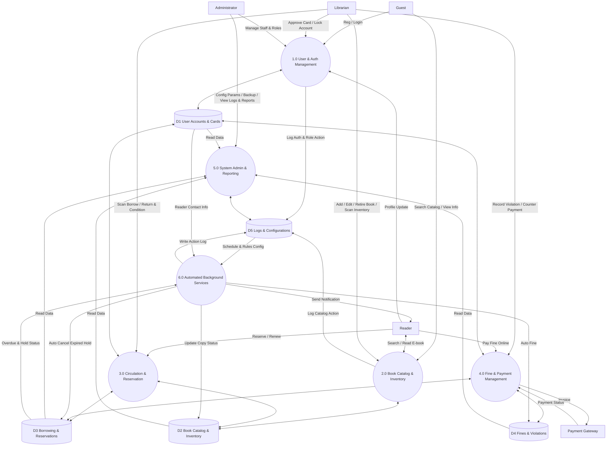

# Software Requirements Specification and Design Document
**Project Name:** Library Management System (LMS)

## 1. Functional Requirements

### 1.1 Overview

This section lists the functional requirements of the Library Management System (LMS), grouped by actor.

**Actors**

- **Guest**: a visitor who accesses the system but has not logged in.
- **Reader**: a member who already has an account and has logged in successfully. A Reader inherits all Guest functions.
- **Librarian**: library staff responsible for physical and digital library operations.
- **Administrator**: the user with the highest authority, responsible for configuring and managing the whole system.
- **System**: the automatic actor that performs programmed tasks on a schedule or on an event, without direct human action.

**Conventions**

- The word **"shall"** indicates a mandatory requirement.
- Requirement IDs use the format `FR-<ACTOR>-<NN>`.

---

### 1.2 Guest

| ID | Requirement |
|---|---|
| FR-GST-01 | The system shall allow a Guest to register an account, or to request a library card, by entering personal information (full name, email, phone number, etc.). The system shall validate input data and check for duplicate email, phone number, or ID before creating the account. |
| FR-GST-02 | The system shall allow a Guest to search public books by title, author, or category and to see whether a book is still available or out of stock. A Guest shall not be able to borrow or reserve a book. |
| FR-GST-03 | The system shall allow a Guest to view the library's regulations, opening hours, events, and latest news. |
| FR-GST-04 | The system shall allow a Guest to log in by entering an account and a password, and shall then give the user the role of Reader, Librarian, or Administrator according to the account. If the credentials are invalid or the account is locked, the system shall display an appropriate error message. |

### 1.3 Reader

| ID | Requirement |
|---|---|
| FR-RDR-01 | The system shall give a Reader all functions of a Guest (searching books and viewing library information). |
| FR-RDR-02 | The system shall allow a Reader to view and update personal information, including changing the password, updating the avatar, and changing the phone number or contact email. |
| FR-RDR-03 | The system shall allow a Reader to reserve a book online, whether the book is on the shelf or currently borrowed by another Reader. |
| FR-RDR-04 | The system shall allow a Reader to send a renewal request, asking for more borrowing time, for books that are close to their due date. |
| FR-RDR-05 | The system shall approve a renewal request only if the book is not overdue, the borrowing limit has not been exceeded, and the book has not been reserved by another Reader. |
| FR-RDR-06 | The system shall allow a Reader to view their borrowing history, including the books currently borrowed, the books returned, the return due dates, and the status of their reservations. |
| FR-RDR-07 | The system shall allow a Reader to view the details of fines caused by late returns or damaged books. |
| FR-RDR-08 | If the system integrates a bank or e-wallet payment gateway, the system shall allow a Reader to pay fines online. |
| FR-RDR-09 | The system shall allow a Reader to read e-books and digital course materials online, or to download them in PDF or EPUB format. |

### 1.4 Librarian

| ID | Requirement |
|---|---|
| FR-LIB-01 | The system shall allow a Librarian to add a new book to the system. |
| FR-LIB-02 | The system shall allow a Librarian to edit book information. |
| FR-LIB-03 | The system shall allow a Librarian to classify a book by standard code (DDC/ISBN). |
| FR-LIB-04 | The system shall allow a Librarian to choose the shelf location of a book in the storage. |
| FR-LIB-05 | The system shall allow a Librarian to retire a book by updating its status to canceled, removing old, torn, or outdated books from the circulation catalog. |
| FR-LIB-06 | The system shall allow a Librarian to create a borrowing record at the counter by scanning the Reader's card code and the barcode on each book. |
| FR-LIB-07 | The system shall allow a Librarian to record a returned book by scanning its barcode, updating its status to available in stock, or to reserved if there is an active reservation. |
| FR-LIB-08 | The system shall allow a Librarian to check and record the condition of a returned book (whether it is intact). |
| FR-LIB-09 | The system shall allow a Librarian to create a violation record with a fine when a Reader loses or tears a book, or returns a book late. |
| FR-LIB-10 | The system shall allow a Librarian to record that a fine has been paid when the Reader pays at the counter. |
| FR-LIB-11 | The system shall allow a Librarian to review and approve registrations for new library cards. |
| FR-LIB-12 | The system shall allow a Librarian to lock or unlock a Reader's account according to the Reader's violations of library regulations. |
| FR-LIB-13 | The system shall allow a Librarian to perform periodic batch barcode scanning to compare the actual number of books on the shelves with the data shown in the software. |

### 1.5 Administrator

| ID | Requirement |
|---|---|
| FR-ADM-01 | The system shall allow an Administrator to add new Librarian accounts, edit their information, or lock them. |
| FR-ADM-02 | The system shall allow an Administrator to define roles and assign specific permissions to them (for example, one Librarian may manage only borrowing and returning, while another manages only the book storage). |
| FR-ADM-03 | The system shall allow an Administrator to configure library parameters: the maximum number of books a Reader may borrow, the maximum number of borrowing days, and the fine amount per day of late return. |
| FR-ADM-04 | The system shall allow an Administrator to view and export charts and reports on borrowing frequency, the total number of new Readers, and the total fines collected, by month or by year. |
| FR-ADM-05 | The system shall allow an Administrator to back up the database. |
| FR-ADM-06 | The system shall allow an Administrator to restore the system from a backup when a technical failure occurs. |
| FR-ADM-07 | The system shall allow an Administrator to view system audit logs (recording user login history, critical data modifications, and configuration changes) for security and auditing purposes. |

### 1.6 System (Automatic Functions)

| ID | Requirement |
|---|---|
| FR-SYS-01 | The system shall scan all borrowing records periodically every day (for example at 00:00) and, for each overdue record, automatically add the fine to the Reader's account. |
| FR-SYS-02 | The system shall automatically send reminders to Readers by email, SMS, or in-app notification when a book is due soon (2 days before the due date), when a book is overdue, or when a reserved book is available on the shelf for pickup. |
| FR-SYS-03 | The system shall automatically cancel a reservation hold if the Reader does not pick up the book within X days (for example 3 days) after the book is placed on the waiting shelf, and shall return the book to the available state or assign it to the next Reader in the reservation queue. |
| FR-SYS-04 | The system shall automatically log the actions of Librarians and Administrators (for example who edited a book or who deleted an account) for security and error-tracing purposes. |

## 2. Non-Functional Requirements

### 2.1 Overview

This section describes the quality requirements of the Library Management System (LMS): how well the system shall perform, not what functions it provides. Each requirement is written to be measurable where possible.

**Conventions**

- The word **"shall"** indicates a mandatory requirement.
- Requirement IDs use the format `NFR-<CATEGORY>-<NN>`.
- The numeric values (response times, number of users, and so on) are **proposed targets**. The team shall confirm them with the instructor before treating them as final.
- The "Related FR" column links a requirement to the functional requirements in Section 1.

---

### 2.2 Performance

| ID | Requirement | Related FR |
|---|---|---|
| NFR-PER-01 | The system shall return book search results within 2.0 seconds under normal load for a database containing up to 100,000 book records. | FR-GST-02 |
| NFR-PER-02 | The system shall save a borrowing or returning transaction and show the result to the Librarian within 2.0 seconds after the barcode is scanned. | FR-LIB-06, FR-LIB-07 |
| NFR-PER-03 | The system shall support at least 100 concurrent active users without more than 10% degradation in average response time. | All |
| NFR-PER-04 | The daily scan of borrowing records (fine calculation and notification dispatch) shall complete within 30 minutes during off-peak hours (e.g., at 00:00) without degrading online system performance. | FR-SYS-01, FR-SYS-02 |
| NFR-PER-05 | The web application shall load its initial interface within 2.5 seconds for at least 95% of user requests under standard network conditions. | All |

### 2.3 Security

| ID | Requirement | Related FR |
|---|---|---|
| NFR-SEC-01 | The system shall store user passwords using a strong, salted hashing algorithm (e.g., Bcrypt with cost factor >= 12 or Argon2) and shall never store passwords in plain text. | FR-GST-04, FR-RDR-02 |
| NFR-SEC-02 | The system shall encrypt all communication between the user's client browser and the server using HTTPS over TLS v1.2 or TLS v1.3. | All |
| NFR-SEC-03 | The system shall enforce Role-Based Access Control (RBAC). A user shall not be able to access functions or data outside their assigned role permissions, including direct URL manipulation. | FR-ADM-02 |
| NFR-SEC-04 | A Reader shall be restricted to viewing only their own personal profile, borrowing history, and fine details. | FR-RDR-02, FR-RDR-06, FR-RDR-07 |
| NFR-SEC-05 | The system shall automatically terminate a user session after 30 minutes of inactivity. | FR-GST-04 |
| NFR-SEC-06 | The system shall temporarily lock an account for 15 minutes after 5 consecutive failed login attempts to prevent brute-force attacks. | FR-GST-04 |
| NFR-SEC-07 | The system shall sanitize and validate all user inputs to protect against common web vulnerabilities, including SQL Injection, Cross-Site Scripting (XSS), and CSRF. | All |
| NFR-SEC-08 | The system logs of Librarian and Administrator actions shall be write-once/read-only (immutable via the application), and shall only be viewable by an Administrator. | FR-SYS-04, FR-ADM-07 |
| NFR-SEC-09 | The system shall not store any credit card, bank, or e-wallet account credentials. All payment processing shall be delegated securely to third-party payment gateways. | FR-RDR-08 |
| NFR-SEC-10 | Only authenticated and authorized Readers with active accounts shall be permitted to read online or download digital course materials (E-books). | FR-RDR-09 |

### 2.4 Reliability, Availability, and Data Integrity

| ID | Requirement | Related FR |
|---|---|---|
| NFR-REL-01 | The system shall maintain an uptime availability of at least 99.5% during library operational hours, excluding scheduled maintenance windows. | All |
| NFR-REL-02 | The system shall enforce transactional ACID properties. If a borrowing or returning transaction fails midway, the system shall perform an automatic rollback to prevent partial or inconsistent data. | FR-LIB-06, FR-LIB-07 |
| NFR-REL-03 | The system shall implement database concurrency control (e.g., pessimistic locking) to prevent race conditions when two Librarians attempt to process the exact same book copy simultaneously. | FR-LIB-06 |
| NFR-REL-04 | The system shall perform automated daily database backups at 00:00 and store copies in two physically isolated locations (e.g., local backup server and cloud storage). | FR-ADM-05 |
| NFR-REL-05 | Following a hardware or system failure, the system shall achieve a Recovery Time Objective (RTO) of <= 4 hours and a Recovery Point Objective (RPO) of <= 24 hours. | FR-ADM-06 |
| NFR-REL-06 | The system shall handle notification dispatching asynchronously with automated retry mechanisms, ensuring that notification delivery failures do not block core system transactions. | FR-SYS-02 |

### 2.5 Usability

| ID | Requirement | Related FR |
|---|---|---|
| NFR-USA-01 | The primary user interface language shall be Vietnamese, using UTF-8 character encoding across all displays, forms, and database transactions. | All |
| NFR-USA-02 | A newly recruited Librarian shall be able to perform standard borrowing and returning transactions without supervision after at most 4 hours (half a day) of system training. | FR-LIB-06, FR-LIB-07 |
| NFR-USA-03 | The system shall display clear, actionable, and non-technical error messages that state the cause of the issue and guide the user on how to proceed. | All |
| NFR-USA-04 | The public portal (Guest and Reader interfaces) shall feature a responsive design that displays correctly across major desktop and mobile web browsers (Chrome, Safari, Firefox, Edge) down to a viewport width of 360px. | FR-GST-02, FR-RDR-06, FR-RDR-09 |
| NFR-USA-05 | The system shall require explicit user confirmation via modal dialogs before executing non-reversible or destructive actions (e.g., retiring books, locking accounts, or modifying global configuration). | FR-LIB-05, FR-LIB-12, FR-ADM-01, FR-ADM-03 |

### 2.6 Compatibility and Localization

| ID | Requirement | Related FR |
|---|---|---|
| NFR-COM-01 | The web application shall be fully compatible with the latest two major stable versions of major web browsers (Google Chrome, Microsoft Edge, Mozilla Firefox, Apple Safari) on both desktop and mobile platforms. | All |
| NFR-COM-02 | The system shall interface seamlessly with standard USB/Bluetooth barcode scanners operating in Human Interface Device (HID) / Keyboard Wedge emulation mode. | FR-LIB-06, FR-LIB-07, FR-LIB-13 |
| NFR-COM-03 | The system shall fully support Vietnamese localization (L10n), utilizing UTF-8 character encoding, formatting dates as DD/MM/YYYY, displaying currency in VND, and synchronizing timestamps with the Indochina Time zone (UTC+7). | All |
| NFR-COM-04 | The digital library component shall support processing, online rendering, and downloading of digital course materials in standard PDF and EPUB file formats. | FR-RDR-09 |

### 2.7 Maintainability and Scalability

| ID | Requirement | Related FR |
|---|---|---|
| NFR-MNT-01 | The system architecture shall follow a modular design (e.g., Layered Architecture / MVC) ensuring low coupling and high cohesion, so that modifications in one module (e.g., User, Catalog, Circulation, Report) do not impact others. | All |
| NFR-MNT-02 | Global business parameters (e.g., maximum borrowing limits, loan duration, daily overdue fine rates) shall be dynamically configurable via the Administrator interface without requiring source code modifications or system redeployment. | FR-ADM-03 |
| NFR-MNT-03 | The codebase shall adhere strictly to established industry coding standards, maintain comprehensive inline documentation, and provide clean API specifications to facilitate onboarding for new developers. | All |
| NFR-MNT-04 | The database schema and indexing strategy shall be designed to scale seamlessly, supporting at least 100,000 book records, 10,000 active Reader accounts, and up to 500,000 transaction logs without architectural redesign. | All |

## 3. Data Flow Diagram (DFD)

### 3.1 Context Diagram (Level 0 DFD)

The Context Diagram defines the system boundary of the Library Management System (LMS), illustrating the central system (`0.0`) and its interactions with external entities.

#### External Entities

- **Guest**: Unauthenticated visitors who browse public catalogs, view news/events, or register/log in.
- **Reader**: Authenticated members who search/read e-books, reserve/renew books, view loan history/fines, and pay fines online.
- **Librarian**: Library staff managing book cataloging, counter borrowing/returning, inventory auditing, and violation records.
- **Administrator**: System managers configuring system parameters, managing staff accounts and permissions, backing up data, and inspecting audit logs.
- **Payment Gateway**: External third-party financial service handling online fine payments.

View Level 0 DFD

### 3.2 List of Data Stores

The system relies on five persistent data stores to maintain data integrity and support system functions:

| Store ID | Data Store Name | Description | Related FRs |
|---|---|---|---|
| D1 | User Accounts & Cards | Stores user credentials, profiles, assigned roles/permissions, account statuses, and library cards. | FR-GST-01, FR-GST-04, FR-RDR-02, FR-LIB-11, FR-LIB-12, FR-ADM-01, FR-ADM-02, FR-ADM-04 (read) |
| D2 | Book Catalog & Inventory | Stores bibliographic metadata (ISBN, DDC, title, author), e-books (PDF/EPUB), physical copies, shelf locations, and status (Available, Borrowed, Reserved, Canceled). | FR-GST-02, FR-GST-03, FR-RDR-01, FR-RDR-09, FR-LIB-01 to FR-LIB-05, FR-LIB-13, FR-ADM-04 (read) |
| D3 | Borrowing & Reservations | Stores active loan records, return due dates, returned book conditions, renewal counts, historical transactions, and online reservation queues. | FR-RDR-03 to FR-RDR-06, FR-LIB-06 to FR-LIB-08, FR-SYS-03, FR-ADM-04 (read) |
| D4 | Fines & Violation Records | Stores violation tickets, calculated overdue fine amounts, counter/online payment receipts, and payment statuses. | FR-RDR-07, FR-RDR-08, FR-LIB-09, FR-LIB-10, FR-SYS-01, FR-ADM-04 (read) |
| D5 | System Logs & Configurations | Stores global operational settings (loan limits, fine rates), backup metadata, and immutable system audit logs. | FR-ADM-03, FR-ADM-05 to FR-ADM-07, FR-SYS-02, FR-SYS-04 |

### 3.3 Level 1 DFD (Subsystem Decomposition)

The central process (`0.0`) is decomposed into 6 functional processes:

> **Note:** Mermaid has no built-in symbol for the standard DFD data store (two parallel lines / open-ended rectangle), so the data stores appear as cylinders in this source code. The final diagram images exported from draw.io shall use the standard DFD data store symbol.

#### Detailed Process Descriptions

##### Process 1.0: User & Authentication Management

- **Description:** Handles account registration, credential verification, profile updates, library card approvals, account locking/unlocking, and RBAC role/permission enforcement.
- **Inputs:** Registration forms, login credentials, profile updates, card approval/lock commands, staff/role assignments.
- **Outputs:** Authentication tokens/session, profile view, registration confirmation, account status updates.
- **Data Stores:** Reads/Writes D1 (User Accounts & Cards), Writes D5 (Logs & Configurations).

##### Process 2.0: Book Catalog & Inventory Management

- **Description:** Manages cataloging of new books, DDC/ISBN classification, physical shelf location assignment, book retirement, physical inventory batch auditing, public searching, and e-book delivery.
- **Inputs:** Search criteria, e-book access requests, bibliographic records, shelf locations, retirement status, batch inventory barcode scans.
- **Outputs:** Catalog search results, e-book files (PDF/EPUB), book copy availability statuses, inventory discrepancy reports.
- **Data Stores:** Reads/Writes D2 (Book Catalog & Inventory), Writes D5 (Logs & Configurations).

##### Process 3.0: Circulation & Reservation Processing

- **Description:** Processes counter borrowing/returning via barcode scanning, records returned book condition, validates online reservation requests, and evaluates loan renewal eligibility.
- **Inputs:** Card barcodes, book copy barcodes, returned book condition, online reservation triggers, renewal requests.
- **Outputs:** Loan confirmation, return receipt, updated book copy status (Available / Reserved), renewal approval/rejection.
- **Data Stores:** Reads D1, Reads/Writes D2, Reads/Writes D3 (Borrowing & Reservations).

##### Process 4.0: Fine Management & Payment Processing

- **Description:** Records library violations, calculates fines, logs counter payments, and integrates with the Payment Gateway for online fine settlement.
- **Inputs:** Violation records (lost/damaged/late), counter payment confirmations, online payment callbacks.
- **Outputs:** Detailed fine statements, payment invoices, payment confirmation receipts, account status updates.
- **Data Stores:** Reads D3, Reads/Writes D4 (Fines & Violation Records), Reads/Writes D1.

##### Process 5.0: System Administration, Audit & Reporting

- **Description:** Allows administrators to configure global library parameters, view/export statistical reports, perform database backups/restores, and review audit logs.
- **Inputs:** Configuration parameters, report filter parameters, database backup/restore commands.
- **Outputs:** Analytical charts/reports, system configuration confirmation, database archive files, system audit log views.
- **Data Stores:** Reads D1, D2, D3, D4; Reads/Writes D5 (Logs & Configurations).

##### Process 6.0: Automated Background Services

- **Description:** Executes daily scheduled jobs (e.g., at 00:00) to calculate overdue fines, dispatch due/overdue/pickup reminders, cancel expired hold reservations, and log automated actions. The time trigger is defined by the schedule configuration read from D5, so it is not drawn as a separate data flow.
- **Inputs:** Scheduled timer trigger and library parameters from D5, active loan/reservation records from D3, Reader contact information from D1.
- **Outputs:** Automated fine entries, email/SMS/in-app notifications to Readers, reservation queue and book status updates, system log entries.
- **Data Stores:** Reads D1, Reads/Writes D2, Reads/Writes D3, Reads/Writes D4, Reads/Writes D5.

## 4. Use Case Diagram

*(To be updated)*

## 5. Class Diagram

*(To be updated)*

## 6. Data Model

*(To be updated)*

## 7. Interface Design Description

*(To be updated)*
