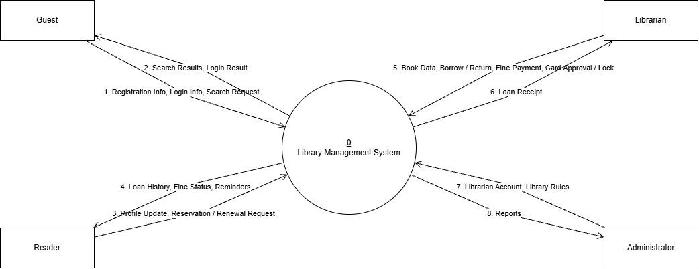
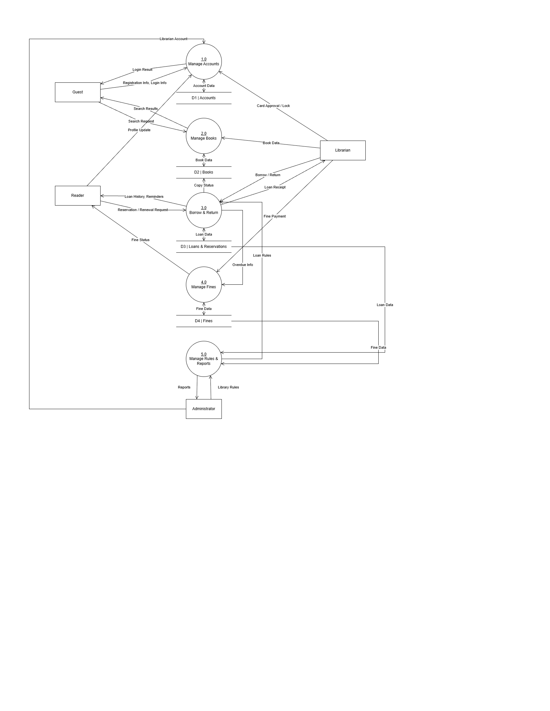
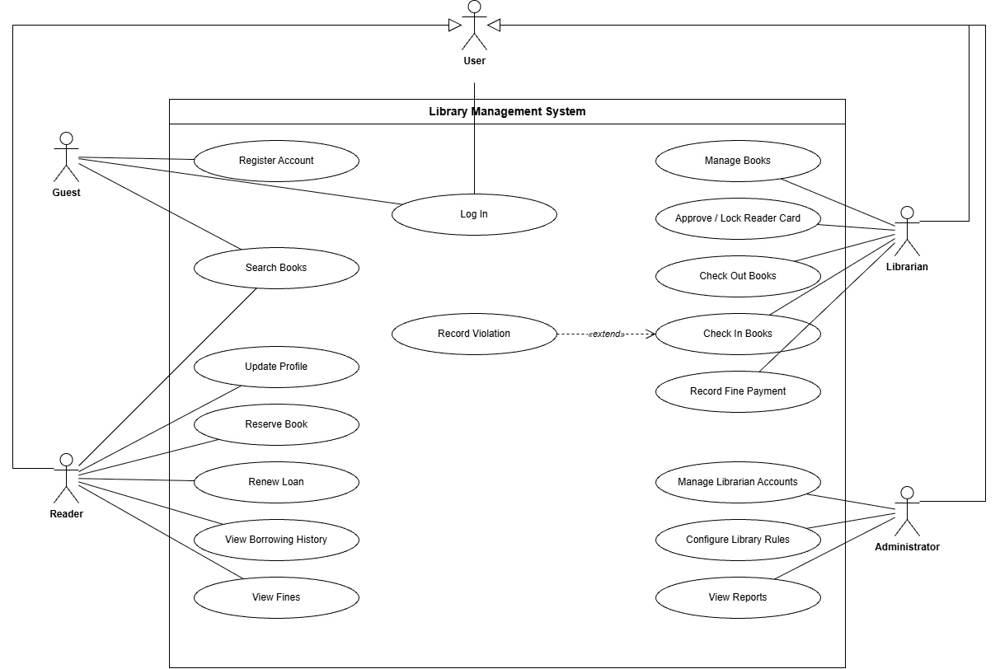

# Software Requirements Specification and Design Document
**Project Name:** Library Management System (LMS)

## 1. Functional Requirements

### 1.1 Overview

This section lists the functional requirements of the Library Management System (LMS), grouped by actor.

**Actors**

- **Guest**: a visitor who accesses the system but has not logged in.
- **Reader**: a member who already has an account and has logged in successfully. A Reader inherits all Guest functions.
- **Librarian**: library staff responsible for physical and digital library operations.
- **Administrator**: the user with the highest authority, responsible for configuring and managing the whole system.
- **System**: the automatic actor that performs programmed tasks on a schedule or on an event, without direct human action.

**Conventions**

- The word **"shall"** indicates a mandatory requirement.
- Requirement IDs use the format `FR-<ACTOR>-<NN>`.

---

### 1.2 Guest

| ID | Requirement |
|---|---|
| FR-GST-01 | The system shall allow a Guest to register an account, or to request a library card, by entering personal information (full name, email, phone number, etc.). The system shall validate input data and check for duplicate email, phone number, or ID before creating the account. |
| FR-GST-02 | The system shall allow a Guest to search public books by title, author, or category and to see whether a book is still available or out of stock. A Guest shall not be able to borrow or reserve a book. |
| FR-GST-03 | The system shall allow a Guest to view the library's regulations, opening hours, events, and latest news. |
| FR-GST-04 | The system shall allow a Guest to log in by entering an account and a password, and shall then give the user the role of Reader, Librarian, or Administrator according to the account. If the credentials are invalid or the account is locked, the system shall display an appropriate error message. |

### 1.3 Reader

| ID | Requirement |
|---|---|
| FR-RDR-01 | The system shall give a Reader all functions of a Guest (searching books and viewing library information). |
| FR-RDR-02 | The system shall allow a Reader to view and update personal information, including changing the password, updating the avatar, and changing the phone number or contact email. |
| FR-RDR-03 | The system shall allow a Reader to reserve a book online, whether the book is on the shelf or currently borrowed by another Reader. |
| FR-RDR-04 | The system shall allow a Reader to send a renewal request, asking for more borrowing time, for books that are close to their due date. |
| FR-RDR-05 | The system shall approve a renewal request only if the book is not overdue, the borrowing limit has not been exceeded, and the book has not been reserved by another Reader. |
| FR-RDR-06 | The system shall allow a Reader to view their borrowing history, including the books currently borrowed, the books returned, the return due dates, and the status of their reservations. |
| FR-RDR-07 | The system shall allow a Reader to view the details of fines caused by late returns or damaged books. |
| FR-RDR-08 | If the system integrates a bank or e-wallet payment gateway, the system shall allow a Reader to pay fines online. |
| FR-RDR-09 | The system shall allow a Reader to read e-books and digital course materials online, or to download them in PDF or EPUB format. |

### 1.4 Librarian

| ID | Requirement |
|---|---|
| FR-LIB-01 | The system shall allow a Librarian to add a new book to the system. |
| FR-LIB-02 | The system shall allow a Librarian to edit book information. |
| FR-LIB-03 | The system shall allow a Librarian to classify a book by standard code (DDC/ISBN). |
| FR-LIB-04 | The system shall allow a Librarian to choose the shelf location of a book in the storage. |
| FR-LIB-05 | The system shall allow a Librarian to retire a book by updating its status to canceled, removing old, torn, or outdated books from the circulation catalog. |
| FR-LIB-06 | The system shall allow a Librarian to create a borrowing record at the counter by scanning the Reader's card code and the barcode on each book. |
| FR-LIB-07 | The system shall allow a Librarian to record a returned book by scanning its barcode, updating its status to available in stock, or to reserved if there is an active reservation. |
| FR-LIB-08 | The system shall allow a Librarian to check and record the condition of a returned book (whether it is intact). |
| FR-LIB-09 | The system shall allow a Librarian to create a violation record with a fine when a Reader loses or tears a book, or returns a book late. |
| FR-LIB-10 | The system shall allow a Librarian to record that a fine has been paid when the Reader pays at the counter. |
| FR-LIB-11 | The system shall allow a Librarian to review and approve registrations for new library cards. |
| FR-LIB-12 | The system shall allow a Librarian to lock or unlock a Reader's account according to the Reader's violations of library regulations. |
| FR-LIB-13 | The system shall allow a Librarian to perform periodic batch barcode scanning to compare the actual number of books on the shelves with the data shown in the software. |

### 1.5 Administrator

| ID | Requirement |
|---|---|
| FR-ADM-01 | The system shall allow an Administrator to add new Librarian accounts, edit their information, or lock them. |
| FR-ADM-02 | The system shall allow an Administrator to define roles and assign specific permissions to them (for example, one Librarian may manage only borrowing and returning, while another manages only the book storage). |
| FR-ADM-03 | The system shall allow an Administrator to configure library parameters: the maximum number of books a Reader may borrow, the maximum number of borrowing days, and the fine amount per day of late return. |
| FR-ADM-04 | The system shall allow an Administrator to view and export charts and reports on borrowing frequency, the total number of new Readers, and the total fines collected, by month or by year. |
| FR-ADM-05 | The system shall allow an Administrator to back up the database. |
| FR-ADM-06 | The system shall allow an Administrator to restore the system from a backup when a technical failure occurs. |
| FR-ADM-07 | The system shall allow an Administrator to view system audit logs (recording user login history, critical data modifications, and configuration changes) for security and auditing purposes. |

### 1.6 System (Automatic Functions)

| ID | Requirement |
|---|---|
| FR-SYS-01 | The system shall scan all borrowing records periodically every day (for example at 00:00) and, for each overdue record, automatically add the fine to the Reader's account. |
| FR-SYS-02 | The system shall automatically send reminders to Readers by email, SMS, or in-app notification when a book is due soon (2 days before the due date), when a book is overdue, or when a reserved book is available on the shelf for pickup. |
| FR-SYS-03 | The system shall automatically cancel a reservation hold if the Reader does not pick up the book within X days (for example 3 days) after the book is placed on the waiting shelf, and shall return the book to the available state or assign it to the next Reader in the reservation queue. |
| FR-SYS-04 | The system shall automatically log the actions of Librarians and Administrators (for example who edited a book or who deleted an account) for security and error-tracing purposes. |

## 2. Non-Functional Requirements

### 2.1 Overview

This section describes the quality requirements of the Library Management System (LMS): how well the system shall perform, not what functions it provides. Each requirement is written to be measurable where possible.

**Conventions**

- The word **"shall"** indicates a mandatory requirement.
- Requirement IDs use the format `NFR-<CATEGORY>-<NN>`.
- The numeric values (response times, number of users, and so on) are **proposed targets**. The team shall confirm them with the instructor before treating them as final.
- The "Related FR" column links a requirement to the functional requirements in Section 1.

---

### 2.2 Performance

| ID | Requirement | Related FR |
|---|---|---|
| NFR-PER-01 | The system shall return book search results within 2.0 seconds under normal load for a database containing up to 100,000 book records. | FR-GST-02 |
| NFR-PER-02 | The system shall save a borrowing or returning transaction and show the result to the Librarian within 2.0 seconds after the barcode is scanned. | FR-LIB-06, FR-LIB-07 |
| NFR-PER-03 | The system shall support at least 100 concurrent active users without more than 10% degradation in average response time. | All |
| NFR-PER-04 | The daily scan of borrowing records (fine calculation and notification dispatch) shall complete within 30 minutes during off-peak hours (e.g., at 00:00) without degrading online system performance. | FR-SYS-01, FR-SYS-02 |
| NFR-PER-05 | The web application shall load its initial interface within 2.5 seconds for at least 95% of user requests under standard network conditions. | All |

### 2.3 Security

| ID | Requirement | Related FR |
|---|---|---|
| NFR-SEC-01 | The system shall store user passwords using a strong, salted hashing algorithm (e.g., Bcrypt with cost factor >= 12 or Argon2) and shall never store passwords in plain text. | FR-GST-04, FR-RDR-02 |
| NFR-SEC-02 | The system shall encrypt all communication between the user's client browser and the server using HTTPS over TLS v1.2 or TLS v1.3. | All |
| NFR-SEC-03 | The system shall enforce Role-Based Access Control (RBAC). A user shall not be able to access functions or data outside their assigned role permissions, including direct URL manipulation. | FR-ADM-02 |
| NFR-SEC-04 | A Reader shall be restricted to viewing only their own personal profile, borrowing history, and fine details. | FR-RDR-02, FR-RDR-06, FR-RDR-07 |
| NFR-SEC-05 | The system shall automatically terminate a user session after 30 minutes of inactivity. | FR-GST-04 |
| NFR-SEC-06 | The system shall temporarily lock an account for 15 minutes after 5 consecutive failed login attempts to prevent brute-force attacks. | FR-GST-04 |
| NFR-SEC-07 | The system shall sanitize and validate all user inputs to protect against common web vulnerabilities, including SQL Injection, Cross-Site Scripting (XSS), and CSRF. | All |
| NFR-SEC-08 | The system logs of Librarian and Administrator actions shall be write-once/read-only (immutable via the application), and shall only be viewable by an Administrator. | FR-SYS-04, FR-ADM-07 |
| NFR-SEC-09 | The system shall not store any credit card, bank, or e-wallet account credentials. All payment processing shall be delegated securely to third-party payment gateways. | FR-RDR-08 |
| NFR-SEC-10 | Only authenticated and authorized Readers with active accounts shall be permitted to read online or download digital course materials (E-books). | FR-RDR-09 |

### 2.4 Reliability, Availability, and Data Integrity

| ID | Requirement | Related FR |
|---|---|---|
| NFR-REL-01 | The system shall maintain an uptime availability of at least 99.5% during library operational hours, excluding scheduled maintenance windows. | All |
| NFR-REL-02 | The system shall enforce transactional ACID properties. If a borrowing or returning transaction fails midway, the system shall perform an automatic rollback to prevent partial or inconsistent data. | FR-LIB-06, FR-LIB-07 |
| NFR-REL-03 | The system shall implement database concurrency control (e.g., pessimistic locking) to prevent race conditions when two Librarians attempt to process the exact same book copy simultaneously. | FR-LIB-06 |
| NFR-REL-04 | The system shall perform automated daily database backups at 00:00 and store copies in two physically isolated locations (e.g., local backup server and cloud storage). | FR-ADM-05 |
| NFR-REL-05 | Following a hardware or system failure, the system shall achieve a Recovery Time Objective (RTO) of <= 4 hours and a Recovery Point Objective (RPO) of <= 24 hours. | FR-ADM-06 |
| NFR-REL-06 | The system shall handle notification dispatching asynchronously with automated retry mechanisms, ensuring that notification delivery failures do not block core system transactions. | FR-SYS-02 |

### 2.5 Usability

| ID | Requirement | Related FR |
|---|---|---|
| NFR-USA-01 | The primary user interface language shall be Vietnamese, using UTF-8 character encoding across all displays, forms, and database transactions. | All |
| NFR-USA-02 | A newly recruited Librarian shall be able to perform standard borrowing and returning transactions without supervision after at most 4 hours (half a day) of system training. | FR-LIB-06, FR-LIB-07 |
| NFR-USA-03 | The system shall display clear, actionable, and non-technical error messages that state the cause of the issue and guide the user on how to proceed. | All |
| NFR-USA-04 | The public portal (Guest and Reader interfaces) shall feature a responsive design that displays correctly across major desktop and mobile web browsers (Chrome, Safari, Firefox, Edge) down to a viewport width of 360px. | FR-GST-02, FR-RDR-06, FR-RDR-09 |
| NFR-USA-05 | The system shall require explicit user confirmation via modal dialogs before executing non-reversible or destructive actions (e.g., retiring books, locking accounts, or modifying global configuration). | FR-LIB-05, FR-LIB-12, FR-ADM-01, FR-ADM-03 |

### 2.6 Compatibility and Localization

| ID | Requirement | Related FR |
|---|---|---|
| NFR-COM-01 | The web application shall be fully compatible with the latest two major stable versions of major web browsers (Google Chrome, Microsoft Edge, Mozilla Firefox, Apple Safari) on both desktop and mobile platforms. | All |
| NFR-COM-02 | The system shall interface seamlessly with standard USB/Bluetooth barcode scanners operating in Human Interface Device (HID) / Keyboard Wedge emulation mode. | FR-LIB-06, FR-LIB-07, FR-LIB-13 |
| NFR-COM-03 | The system shall fully support Vietnamese localization (L10n), utilizing UTF-8 character encoding, formatting dates as DD/MM/YYYY, displaying currency in VND, and synchronizing timestamps with the Indochina Time zone (UTC+7). | All |
| NFR-COM-04 | The digital library component shall support processing, online rendering, and downloading of digital course materials in standard PDF and EPUB file formats. | FR-RDR-09 |

### 2.7 Maintainability and Scalability

| ID | Requirement | Related FR |
|---|---|---|
| NFR-MNT-01 | The system architecture shall follow a modular design (e.g., Layered Architecture / MVC) ensuring low coupling and high cohesion, so that modifications in one module (e.g., User, Catalog, Circulation, Report) do not impact others. | All |
| NFR-MNT-02 | Global business parameters (e.g., maximum borrowing limits, loan duration, daily overdue fine rates) shall be dynamically configurable via the Administrator interface without requiring source code modifications or system redeployment. | FR-ADM-03 |
| NFR-MNT-03 | The codebase shall adhere strictly to established industry coding standards, maintain comprehensive inline documentation, and provide clean API specifications to facilitate onboarding for new developers. | All |
| NFR-MNT-04 | The database schema and indexing strategy shall be designed to scale seamlessly, supporting at least 100,000 book records, 10,000 active Reader accounts, and up to 500,000 transaction logs without architectural redesign. | All |

## 3. Data Flow Diagram (DFD)

### 3.1 Scope

The DFDs cover account management, book management, borrowing and returning, fines, and library rules and reports. The following requirements from Section 1 are left out of the diagrams:

| Requirement | Reason |
|---|---|
| FR-GST-03 (library information, news, events) | Static content with no data processing |
| FR-RDR-08 (online fine payment), FR-RDR-09 (e-books) | Optional in Section 1 ("if the system integrates...") |
| FR-LIB-13 (inventory audit) | Periodic task outside the daily workflow |
| FR-ADM-02, FR-ADM-05 to FR-ADM-07 (permissions, backup, restore, audit logs) | System maintenance |
| FR-SYS-04 (automatic action logging) | Internal behavior with no user-visible data flow |

FR-SYS-01 to FR-SYS-03 (overdue fines, reminders, expired holds) are handled inside processes 3.0 and 4.0.

### 3.2 Context Diagram (Level 0 DFD)

The whole system is drawn as one process, `0.0 Library Management System`, connected to four external entities.

#### External Entities

| Entity | Description |
|---|---|
| Guest | Visitor who has not logged in. Registers, logs in, and searches books. |
| Reader | Library member. Reserves and renews books, views loans and fines. |
| Librarian | Staff member. Manages books and reader cards, handles borrowing, returning, and fines at the counter. |
| Administrator | Manages Librarian accounts, library rules, and reports. |

#### Data Flows

| No. | From | To | Data | Related FR |
|---|---|---|---|---|
| 1 | Guest | LMS | Registration Info, Login Info, Search Request | FR-GST-01, FR-GST-02, FR-GST-04 |
| 2 | LMS | Guest | Search Results, Login Result | FR-GST-02, FR-GST-04 |
| 3 | Reader | LMS | Profile Update, Reservation / Renewal Request | FR-RDR-02, FR-RDR-03, FR-RDR-04 |
| 4 | LMS | Reader | Loan History, Fine Status, Reminders | FR-RDR-06, FR-RDR-07, FR-SYS-02 |
| 5 | Librarian | LMS | Book Data, Borrow / Return, Fine Payment, Card Approval / Lock | FR-LIB-01 to FR-LIB-07, FR-LIB-09 to FR-LIB-12 |
| 6 | LMS | Librarian | Loan Receipt | FR-LIB-06, FR-LIB-07 |
| 7 | Administrator | LMS | Librarian Account, Library Rules | FR-ADM-01, FR-ADM-03 |
| 8 | LMS | Administrator | Reports | FR-ADM-04 |

### 3.3 Data Stores

| Store | Name | Content |
|---|---|---|
| D1 | Accounts | User accounts, roles, library cards, card status |
| D2 | Books | Book titles, physical copies, copy status |
| D3 | Loans & Reservations | Borrowing records, due dates, renewals, reservation queues |
| D4 | Fines | Violations, fine amounts, payment status |

### 3.4 Level 1 DFD

Process 0.0 is split into five processes. Each process uses the data store drawn below it.

#### Process Descriptions

| Process | Inputs | Outputs | Data Stores | Related FR |
|---|---|---|---|---|
| 1.0 Manage Accounts | Registration Info, Login Info (Guest); Profile Update (Reader); Card Approval / Lock (Librarian); Librarian Account (Administrator) | Login Result (Guest) | D1 read/write | FR-GST-01, FR-GST-04, FR-RDR-02, FR-LIB-11, FR-LIB-12, FR-ADM-01 |
| 2.0 Manage Books | Search Request (Guest); Book Data (Librarian) | Search Results (Guest) | D2 read/write | FR-GST-02, FR-LIB-01 to FR-LIB-05 |
| 3.0 Borrow & Return | Reservation / Renewal Request (Reader); Borrow / Return (Librarian); Loan Rules (from 5.0) | Loan History, Reminders (Reader); Loan Receipt (Librarian); Overdue Info (to 4.0) | D3 read/write; D2 write (Copy Status) | FR-RDR-03 to FR-RDR-06, FR-LIB-06, FR-LIB-07, FR-SYS-02, FR-SYS-03 |
| 4.0 Manage Fines | Overdue Info (from 3.0); Fine Payment (Librarian) | Fine Status (Reader) | D4 read/write | FR-RDR-07, FR-LIB-09, FR-LIB-10, FR-SYS-01 |
| 5.0 Manage Rules & Reports | Library Rules (Administrator); Loan Data (D3); Fine Data (D4) | Reports (Administrator); Loan Rules (to 3.0) | D3, D4 read | FR-ADM-03, FR-ADM-04 |

#### Balancing with Level 0

The flows between external entities and the system in Level 1 have the same names as in Level 0. Level 1 adds no new external flows. Account Data, Book Data, Loan Data, Copy Status, Fine Data, Overdue Info, and Loan Rules are internal flows.

#### Related Non-Functional Requirements

| Process | NFR | Constraint |
|---|---|---|
| 1.0 | NFR-SEC-01, NFR-SEC-05, NFR-SEC-06 | Passwords are hashed. Sessions end after 30 minutes of inactivity. An account is locked for 15 minutes after 5 failed logins. |
| 1.0 | NFR-SEC-03, NFR-SEC-04 | Access is role-based. A Reader can see only their own data. |
| 2.0 | NFR-PER-01 | Search results within 2 seconds. |
| 3.0 | NFR-PER-02, NFR-REL-02, NFR-REL-03 | A borrow or return is saved within 2 seconds after the scan. A failed transaction is rolled back. One copy cannot be lent to two Readers at once. |
| 3.0 | NFR-PER-04, NFR-REL-06 | The daily overdue scan finishes within 30 minutes. Reminders are sent asynchronously. |
| All | NFR-SEC-07, NFR-USA-01, NFR-COM-03 | Input is validated. The interface is in Vietnamese (UTF-8), dates use DD/MM/YYYY, currency is VND. |

## 4. Use Case Diagram

### 4.1 Overview

The diagram covers the same functions as the DFDs in Section 3.

### 4.2 Actors

| Actor | Description |
|---|---|
| User | Parent actor for every account holder. Linked to Log In. |
| Guest | Visitor who has not logged in. Registers, logs in, and searches books (FR-GST-01, FR-GST-02, FR-GST-04). |
| Reader | Child of User. Library member (FR-RDR-01). |
| Librarian | Child of User. Library staff. |
| Administrator | Child of User. Manages staff accounts and library rules. |

Reader, Librarian, and Administrator get Log In from User through actor generalization, so the diagram does not link them to Log In one by one. After a Guest logs in, the system gives the user the Reader, Librarian, or Administrator role of that account (FR-GST-04).

### 4.3 Use Cases

| Actor | Use Case | Related FR |
|---|---|---|
| Guest | Register Account | FR-GST-01 |
| Guest, Reader | Search Books | FR-GST-02 |
| Guest, User | Log In | FR-GST-04 |
| Reader | Update Profile | FR-RDR-02 |
| Reader | Reserve Book | FR-RDR-03 |
| Reader | Renew Loan | FR-RDR-04, FR-RDR-05 |
| Reader | View Borrowing History | FR-RDR-06 |
| Reader | View Fines | FR-RDR-07 |
| Librarian | Manage Books | FR-LIB-01 to FR-LIB-05 |
| Librarian | Approve / Lock Reader Card | FR-LIB-11, FR-LIB-12 |
| Librarian | Check Out Books | FR-LIB-06 |
| Librarian | Check In Books | FR-LIB-07, FR-LIB-08 |
| Librarian | Record Violation | FR-LIB-09 |
| Librarian | Record Fine Payment | FR-LIB-10 |
| Administrator | Manage Librarian Accounts | FR-ADM-01 |
| Administrator | Configure Library Rules | FR-ADM-03 |
| Administrator | View Reports | FR-ADM-04 |

### 4.4 Relationships

| From | To | Type | Meaning |
|---|---|---|---|
| Reader, Librarian, Administrator | User | Generalization | The three roles inherit Log In from User. |
| Record Violation | Check In Books | `<<extend>>` | Runs only when the returned book is late, damaged, or lost (FR-LIB-09). |
| Actor | Use Case | Association | The actor performs the use case. |

### 4.5 Related Non-Functional Requirements

| Use Case | NFR | Constraint |
|---|---|---|
| Log In | NFR-SEC-01, NFR-SEC-05, NFR-SEC-06 | Hashed passwords, 30-minute session timeout, 15-minute lock after 5 failed attempts |
| Search Books | NFR-PER-01 | Results within 2 seconds |
| View Borrowing History, View Fines | NFR-SEC-04 | A Reader sees only their own data |
| Check Out Books, Check In Books | NFR-PER-02, NFR-REL-02, NFR-REL-03 | Saved within 2 seconds after the scan; rollback on failure; no double loan of one copy |
| All | NFR-SEC-03 | Each role can use only its own use cases |

## 5. Class Diagram

### 5.1 Overview

This section lists the main classes of the Library Management System (LMS) along with their attributes, methods, and relationships.

<mxfile host="app.diagrams.net">
  <diagram name="LMS Class Diagram" id="lms-class">
    <mxGraphModel dx="1460" dy="943" grid="1" gridSize="10" guides="1" tooltips="1" connect="1" arrows="1" fold="1" page="1" pageScale="1" pageWidth="1160" pageHeight="1246" math="0" shadow="0">
      <root>
        <mxCell id="0" />
        <mxCell id="1" parent="0" />
        <mxCell id="NT" parent="1" style="swimlane;fontStyle=1;align=center;verticalAlign=top;childLayout=stackLayout;horizontal=1;startSize=26;horizontalStack=0;resizeParent=1;resizeParentMax=0;resizeLast=0;collapsible=0;marginBottom=0;whiteSpace=wrap;html=1;swimlaneFillColor=#ffffff;fontFamily=Helvetica;fontSize=12;fontColor=#000000;strokeColor=#000000;fillColor=#ffffff;" value="Notification" vertex="1">
          <mxGeometry height="154" width="280" x="40" y="40" as="geometry" />
        </mxCell>
        <mxCell id="NT_0" parent="NT" style="text;strokeColor=none;fillColor=none;align=left;verticalAlign=top;spacingLeft=4;spacingRight=4;overflow=hidden;rotatable=0;points=[[0,0.5],[1,0.5]];portConstraint=eastwest;whiteSpace=wrap;html=1;fontFamily=Helvetica;fontSize=12;fontColor=#000000;" value="- notificationId: int" vertex="1">
          <mxGeometry height="20" width="280" y="26" as="geometry" />
        </mxCell>
        <mxCell id="NT_1" parent="NT" style="text;strokeColor=none;fillColor=none;align=left;verticalAlign=top;spacingLeft=4;spacingRight=4;overflow=hidden;rotatable=0;points=[[0,0.5],[1,0.5]];portConstraint=eastwest;whiteSpace=wrap;html=1;fontFamily=Helvetica;fontSize=12;fontColor=#000000;" value="- channel: String" vertex="1">
          <mxGeometry height="20" width="280" y="46" as="geometry" />
        </mxCell>
        <mxCell id="NT_2" parent="NT" style="text;strokeColor=none;fillColor=none;align=left;verticalAlign=top;spacingLeft=4;spacingRight=4;overflow=hidden;rotatable=0;points=[[0,0.5],[1,0.5]];portConstraint=eastwest;whiteSpace=wrap;html=1;fontFamily=Helvetica;fontSize=12;fontColor=#000000;" value="- message: String" vertex="1">
          <mxGeometry height="20" width="280" y="66" as="geometry" />
        </mxCell>
        <mxCell id="NT_3" parent="NT" style="text;strokeColor=none;fillColor=none;align=left;verticalAlign=top;spacingLeft=4;spacingRight=4;overflow=hidden;rotatable=0;points=[[0,0.5],[1,0.5]];portConstraint=eastwest;whiteSpace=wrap;html=1;fontFamily=Helvetica;fontSize=12;fontColor=#000000;" value="- status: String" vertex="1">
          <mxGeometry height="20" width="280" y="86" as="geometry" />
        </mxCell>
        <mxCell id="NT_4" parent="NT" style="text;strokeColor=none;fillColor=none;align=left;verticalAlign=top;spacingLeft=4;spacingRight=4;overflow=hidden;rotatable=0;points=[[0,0.5],[1,0.5]];portConstraint=eastwest;whiteSpace=wrap;html=1;fontFamily=Helvetica;fontSize=12;fontColor=#000000;" value="- sentAt: Date" vertex="1">
          <mxGeometry height="20" width="280" y="106" as="geometry" />
        </mxCell>
        <mxCell id="NT_5" parent="NT" style="line;strokeWidth=1;fillColor=none;align=left;verticalAlign=middle;spacingTop=-1;spacingLeft=3;spacingRight=3;rotatable=0;labelPosition=right;points=[];portConstraint=eastwest;strokeColor=#000000;" value="" vertex="1">
          <mxGeometry height="8" width="280" y="126" as="geometry" />
        </mxCell>
        <mxCell id="NT_6" parent="NT" style="text;strokeColor=none;fillColor=none;align=left;verticalAlign=top;spacingLeft=4;spacingRight=4;overflow=hidden;rotatable=0;points=[[0,0.5],[1,0.5]];portConstraint=eastwest;whiteSpace=wrap;html=1;fontFamily=Helvetica;fontSize=12;fontColor=#000000;" value="+ send(): boolean" vertex="1">
          <mxGeometry height="20" width="280" y="134" as="geometry" />
        </mxCell>
        <mxCell id="U" parent="1" style="swimlane;fontStyle=1;align=center;verticalAlign=top;childLayout=stackLayout;horizontal=1;startSize=26;horizontalStack=0;resizeParent=1;resizeParentMax=0;resizeLast=0;collapsible=0;marginBottom=0;whiteSpace=wrap;html=1;swimlaneFillColor=#ffffff;fontFamily=Helvetica;fontSize=12;fontColor=#000000;strokeColor=#000000;fillColor=#ffffff;" value="User" vertex="1">
          <mxGeometry height="254" width="280" x="440" y="40" as="geometry" />
        </mxCell>
        <mxCell id="U_0" parent="U" style="text;strokeColor=none;fillColor=none;align=left;verticalAlign=top;spacingLeft=4;spacingRight=4;overflow=hidden;rotatable=0;points=[[0,0.5],[1,0.5]];portConstraint=eastwest;whiteSpace=wrap;html=1;fontFamily=Helvetica;fontSize=12;fontColor=#000000;" value="- userId: int" vertex="1">
          <mxGeometry height="20" width="280" y="26" as="geometry" />
        </mxCell>
        <mxCell id="U_1" parent="U" style="text;strokeColor=none;fillColor=none;align=left;verticalAlign=top;spacingLeft=4;spacingRight=4;overflow=hidden;rotatable=0;points=[[0,0.5],[1,0.5]];portConstraint=eastwest;whiteSpace=wrap;html=1;fontFamily=Helvetica;fontSize=12;fontColor=#000000;" value="- fullName: String" vertex="1">
          <mxGeometry height="20" width="280" y="46" as="geometry" />
        </mxCell>
        <mxCell id="U_2" parent="U" style="text;strokeColor=none;fillColor=none;align=left;verticalAlign=top;spacingLeft=4;spacingRight=4;overflow=hidden;rotatable=0;points=[[0,0.5],[1,0.5]];portConstraint=eastwest;whiteSpace=wrap;html=1;fontFamily=Helvetica;fontSize=12;fontColor=#000000;" value="- email: String" vertex="1">
          <mxGeometry height="20" width="280" y="66" as="geometry" />
        </mxCell>
        <mxCell id="U_3" parent="U" style="text;strokeColor=none;fillColor=none;align=left;verticalAlign=top;spacingLeft=4;spacingRight=4;overflow=hidden;rotatable=0;points=[[0,0.5],[1,0.5]];portConstraint=eastwest;whiteSpace=wrap;html=1;fontFamily=Helvetica;fontSize=12;fontColor=#000000;" value="- phone: String" vertex="1">
          <mxGeometry height="20" width="280" y="86" as="geometry" />
        </mxCell>
        <mxCell id="U_4" parent="U" style="text;strokeColor=none;fillColor=none;align=left;verticalAlign=top;spacingLeft=4;spacingRight=4;overflow=hidden;rotatable=0;points=[[0,0.5],[1,0.5]];portConstraint=eastwest;whiteSpace=wrap;html=1;fontFamily=Helvetica;fontSize=12;fontColor=#000000;" value="- passwordHash: String" vertex="1">
          <mxGeometry height="20" width="280" y="106" as="geometry" />
        </mxCell>
        <mxCell id="U_5" parent="U" style="text;strokeColor=none;fillColor=none;align=left;verticalAlign=top;spacingLeft=4;spacingRight=4;overflow=hidden;rotatable=0;points=[[0,0.5],[1,0.5]];portConstraint=eastwest;whiteSpace=wrap;html=1;fontFamily=Helvetica;fontSize=12;fontColor=#000000;" value="- status: String" vertex="1">
          <mxGeometry height="20" width="280" y="126" as="geometry" />
        </mxCell>
        <mxCell id="U_6" parent="U" style="text;strokeColor=none;fillColor=none;align=left;verticalAlign=top;spacingLeft=4;spacingRight=4;overflow=hidden;rotatable=0;points=[[0,0.5],[1,0.5]];portConstraint=eastwest;whiteSpace=wrap;html=1;fontFamily=Helvetica;fontSize=12;fontColor=#000000;" value="- failedLogins: int" vertex="1">
          <mxGeometry height="20" width="280" y="146" as="geometry" />
        </mxCell>
        <mxCell id="U_7" parent="U" style="text;strokeColor=none;fillColor=none;align=left;verticalAlign=top;spacingLeft=4;spacingRight=4;overflow=hidden;rotatable=0;points=[[0,0.5],[1,0.5]];portConstraint=eastwest;whiteSpace=wrap;html=1;fontFamily=Helvetica;fontSize=12;fontColor=#000000;" value="- lockedUntil: Date" vertex="1">
          <mxGeometry height="20" width="280" y="166" as="geometry" />
        </mxCell>
        <mxCell id="U_8" parent="U" style="line;strokeWidth=1;fillColor=none;align=left;verticalAlign=middle;spacingTop=-1;spacingLeft=3;spacingRight=3;rotatable=0;labelPosition=right;points=[];portConstraint=eastwest;strokeColor=#000000;" value="" vertex="1">
          <mxGeometry height="8" width="280" y="186" as="geometry" />
        </mxCell>
        <mxCell id="U_9" parent="U" style="text;strokeColor=none;fillColor=none;align=left;verticalAlign=top;spacingLeft=4;spacingRight=4;overflow=hidden;rotatable=0;points=[[0,0.5],[1,0.5]];portConstraint=eastwest;whiteSpace=wrap;html=1;fontFamily=Helvetica;fontSize=12;fontColor=#000000;" value="+ login(email, password): boolean" vertex="1">
          <mxGeometry height="20" width="280" y="194" as="geometry" />
        </mxCell>
        <mxCell id="U_10" parent="U" style="text;strokeColor=none;fillColor=none;align=left;verticalAlign=top;spacingLeft=4;spacingRight=4;overflow=hidden;rotatable=0;points=[[0,0.5],[1,0.5]];portConstraint=eastwest;whiteSpace=wrap;html=1;fontFamily=Helvetica;fontSize=12;fontColor=#000000;" value="+ logout(): void" vertex="1">
          <mxGeometry height="20" width="280" y="214" as="geometry" />
        </mxCell>
        <mxCell id="U_11" parent="U" style="text;strokeColor=none;fillColor=none;align=left;verticalAlign=top;spacingLeft=4;spacingRight=4;overflow=hidden;rotatable=0;points=[[0,0.5],[1,0.5]];portConstraint=eastwest;whiteSpace=wrap;html=1;fontFamily=Helvetica;fontSize=12;fontColor=#000000;" value="+ updateProfile(): void" vertex="1">
          <mxGeometry height="20" width="280" y="234" as="geometry" />
        </mxCell>
        <mxCell id="R" parent="1" style="swimlane;fontStyle=1;align=center;verticalAlign=top;childLayout=stackLayout;horizontal=1;startSize=26;horizontalStack=0;resizeParent=1;resizeParentMax=0;resizeLast=0;collapsible=0;marginBottom=0;whiteSpace=wrap;html=1;swimlaneFillColor=#ffffff;fontFamily=Helvetica;fontSize=12;fontColor=#000000;strokeColor=#000000;fillColor=#ffffff;" value="Reader" vertex="1">
          <mxGeometry height="134" width="280" x="40" y="384" as="geometry" />
        </mxCell>
        <mxCell id="R_0" parent="R" style="text;strokeColor=none;fillColor=none;align=left;verticalAlign=top;spacingLeft=4;spacingRight=4;overflow=hidden;rotatable=0;points=[[0,0.5],[1,0.5]];portConstraint=eastwest;whiteSpace=wrap;html=1;fontFamily=Helvetica;fontSize=12;fontColor=#000000;" value="- cardCode: String" vertex="1">
          <mxGeometry height="20" width="280" y="26" as="geometry" />
        </mxCell>
        <mxCell id="R_1" parent="R" style="line;strokeWidth=1;fillColor=none;align=left;verticalAlign=middle;spacingTop=-1;spacingLeft=3;spacingRight=3;rotatable=0;labelPosition=right;points=[];portConstraint=eastwest;strokeColor=#000000;" value="" vertex="1">
          <mxGeometry height="8" width="280" y="46" as="geometry" />
        </mxCell>
        <mxCell id="R_2" parent="R" style="text;strokeColor=none;fillColor=none;align=left;verticalAlign=top;spacingLeft=4;spacingRight=4;overflow=hidden;rotatable=0;points=[[0,0.5],[1,0.5]];portConstraint=eastwest;whiteSpace=wrap;html=1;fontFamily=Helvetica;fontSize=12;fontColor=#000000;" value="+ reserveBook(book: Book): Reservation" vertex="1">
          <mxGeometry height="20" width="280" y="54" as="geometry" />
        </mxCell>
        <mxCell id="R_3" parent="R" style="text;strokeColor=none;fillColor=none;align=left;verticalAlign=top;spacingLeft=4;spacingRight=4;overflow=hidden;rotatable=0;points=[[0,0.5],[1,0.5]];portConstraint=eastwest;whiteSpace=wrap;html=1;fontFamily=Helvetica;fontSize=12;fontColor=#000000;" value="+ requestRenewal(loan: BorrowRecord): boolean" vertex="1">
          <mxGeometry height="20" width="280" y="74" as="geometry" />
        </mxCell>
        <mxCell id="R_4" parent="R" style="text;strokeColor=none;fillColor=none;align=left;verticalAlign=top;spacingLeft=4;spacingRight=4;overflow=hidden;rotatable=0;points=[[0,0.5],[1,0.5]];portConstraint=eastwest;whiteSpace=wrap;html=1;fontFamily=Helvetica;fontSize=12;fontColor=#000000;" value="+ viewBorrowHistory(): List" vertex="1">
          <mxGeometry height="20" width="280" y="94" as="geometry" />
        </mxCell>
        <mxCell id="R_5" parent="R" style="text;strokeColor=none;fillColor=none;align=left;verticalAlign=top;spacingLeft=4;spacingRight=4;overflow=hidden;rotatable=0;points=[[0,0.5],[1,0.5]];portConstraint=eastwest;whiteSpace=wrap;html=1;fontFamily=Helvetica;fontSize=12;fontColor=#000000;" value="+ viewFines(): List" vertex="1">
          <mxGeometry height="20" width="280" y="114" as="geometry" />
        </mxCell>
        <mxCell id="L" parent="1" style="swimlane;fontStyle=1;align=center;verticalAlign=top;childLayout=stackLayout;horizontal=1;startSize=26;horizontalStack=0;resizeParent=1;resizeParentMax=0;resizeLast=0;collapsible=0;marginBottom=0;whiteSpace=wrap;html=1;swimlaneFillColor=#ffffff;fontFamily=Helvetica;fontSize=12;fontColor=#000000;strokeColor=#000000;fillColor=#ffffff;" value="Librarian" vertex="1">
          <mxGeometry height="184" width="280" x="440" y="384" as="geometry" />
        </mxCell>
        <mxCell id="L_0" parent="L" style="text;strokeColor=none;fillColor=none;align=left;verticalAlign=top;spacingLeft=4;spacingRight=4;overflow=hidden;rotatable=0;points=[[0,0.5],[1,0.5]];portConstraint=eastwest;whiteSpace=wrap;html=1;fontFamily=Helvetica;fontSize=12;fontColor=#000000;" value="" vertex="1">
          <mxGeometry height="10" width="280" y="26" as="geometry" />
        </mxCell>
        <mxCell id="L_1" parent="L" style="line;strokeWidth=1;fillColor=none;align=left;verticalAlign=middle;spacingTop=-1;spacingLeft=3;spacingRight=3;rotatable=0;labelPosition=right;points=[];portConstraint=eastwest;strokeColor=#000000;" value="" vertex="1">
          <mxGeometry height="8" width="280" y="36" as="geometry" />
        </mxCell>
        <mxCell id="L_2" parent="L" style="text;strokeColor=none;fillColor=none;align=left;verticalAlign=top;spacingLeft=4;spacingRight=4;overflow=hidden;rotatable=0;points=[[0,0.5],[1,0.5]];portConstraint=eastwest;whiteSpace=wrap;html=1;fontFamily=Helvetica;fontSize=12;fontColor=#000000;" value="+ manageBook(book: Book): void" vertex="1">
          <mxGeometry height="20" width="280" y="44" as="geometry" />
        </mxCell>
        <mxCell id="L_3" parent="L" style="text;strokeColor=none;fillColor=none;align=left;verticalAlign=top;spacingLeft=4;spacingRight=4;overflow=hidden;rotatable=0;points=[[0,0.5],[1,0.5]];portConstraint=eastwest;whiteSpace=wrap;html=1;fontFamily=Helvetica;fontSize=12;fontColor=#000000;" value="+ approveCard(reader: Reader): void" vertex="1">
          <mxGeometry height="20" width="280" y="64" as="geometry" />
        </mxCell>
        <mxCell id="L_4" parent="L" style="text;strokeColor=none;fillColor=none;align=left;verticalAlign=top;spacingLeft=4;spacingRight=4;overflow=hidden;rotatable=0;points=[[0,0.5],[1,0.5]];portConstraint=eastwest;whiteSpace=wrap;html=1;fontFamily=Helvetica;fontSize=12;fontColor=#000000;" value="+ lockReader(reader: Reader): void" vertex="1">
          <mxGeometry height="20" width="280" y="84" as="geometry" />
        </mxCell>
        <mxCell id="L_5" parent="L" style="text;strokeColor=none;fillColor=none;align=left;verticalAlign=top;spacingLeft=4;spacingRight=4;overflow=hidden;rotatable=0;points=[[0,0.5],[1,0.5]];portConstraint=eastwest;whiteSpace=wrap;html=1;fontFamily=Helvetica;fontSize=12;fontColor=#000000;" value="+ checkOut(copy: BookCopy): BorrowRecord" vertex="1">
          <mxGeometry height="20" width="280" y="104" as="geometry" />
        </mxCell>
        <mxCell id="L_6" parent="L" style="text;strokeColor=none;fillColor=none;align=left;verticalAlign=top;spacingLeft=4;spacingRight=4;overflow=hidden;rotatable=0;points=[[0,0.5],[1,0.5]];portConstraint=eastwest;whiteSpace=wrap;html=1;fontFamily=Helvetica;fontSize=12;fontColor=#000000;" value="+ checkIn(copy: BookCopy): void" vertex="1">
          <mxGeometry height="20" width="280" y="124" as="geometry" />
        </mxCell>
        <mxCell id="L_7" parent="L" style="text;strokeColor=none;fillColor=none;align=left;verticalAlign=top;spacingLeft=4;spacingRight=4;overflow=hidden;rotatable=0;points=[[0,0.5],[1,0.5]];portConstraint=eastwest;whiteSpace=wrap;html=1;fontFamily=Helvetica;fontSize=12;fontColor=#000000;" value="+ recordFine(loan: BorrowRecord): Fine" vertex="1">
          <mxGeometry height="20" width="280" y="144" as="geometry" />
        </mxCell>
        <mxCell id="L_8" parent="L" style="text;strokeColor=none;fillColor=none;align=left;verticalAlign=top;spacingLeft=4;spacingRight=4;overflow=hidden;rotatable=0;points=[[0,0.5],[1,0.5]];portConstraint=eastwest;whiteSpace=wrap;html=1;fontFamily=Helvetica;fontSize=12;fontColor=#000000;" value="+ recordPayment(fine: Fine): void" vertex="1">
          <mxGeometry height="20" width="280" y="164" as="geometry" />
        </mxCell>
        <mxCell id="A" parent="1" style="swimlane;fontStyle=1;align=center;verticalAlign=top;childLayout=stackLayout;horizontal=1;startSize=26;horizontalStack=0;resizeParent=1;resizeParentMax=0;resizeLast=0;collapsible=0;marginBottom=0;whiteSpace=wrap;html=1;swimlaneFillColor=#ffffff;fontFamily=Helvetica;fontSize=12;fontColor=#000000;strokeColor=#000000;fillColor=#ffffff;" value="Administrator" vertex="1">
          <mxGeometry height="104" width="280" x="840" y="384" as="geometry" />
        </mxCell>
        <mxCell id="A_0" parent="A" style="text;strokeColor=none;fillColor=none;align=left;verticalAlign=top;spacingLeft=4;spacingRight=4;overflow=hidden;rotatable=0;points=[[0,0.5],[1,0.5]];portConstraint=eastwest;whiteSpace=wrap;html=1;fontFamily=Helvetica;fontSize=12;fontColor=#000000;" value="" vertex="1">
          <mxGeometry height="10" width="280" y="26" as="geometry" />
        </mxCell>
        <mxCell id="A_1" parent="A" style="line;strokeWidth=1;fillColor=none;align=left;verticalAlign=middle;spacingTop=-1;spacingLeft=3;spacingRight=3;rotatable=0;labelPosition=right;points=[];portConstraint=eastwest;strokeColor=#000000;" value="" vertex="1">
          <mxGeometry height="8" width="280" y="36" as="geometry" />
        </mxCell>
        <mxCell id="A_2" parent="A" style="text;strokeColor=none;fillColor=none;align=left;verticalAlign=top;spacingLeft=4;spacingRight=4;overflow=hidden;rotatable=0;points=[[0,0.5],[1,0.5]];portConstraint=eastwest;whiteSpace=wrap;html=1;fontFamily=Helvetica;fontSize=12;fontColor=#000000;" value="+ manageLibrarian(): void" vertex="1">
          <mxGeometry height="20" width="280" y="44" as="geometry" />
        </mxCell>
        <mxCell id="A_3" parent="A" style="text;strokeColor=none;fillColor=none;align=left;verticalAlign=top;spacingLeft=4;spacingRight=4;overflow=hidden;rotatable=0;points=[[0,0.5],[1,0.5]];portConstraint=eastwest;whiteSpace=wrap;html=1;fontFamily=Helvetica;fontSize=12;fontColor=#000000;" value="+ configureRules(): void" vertex="1">
          <mxGeometry height="20" width="280" y="64" as="geometry" />
        </mxCell>
        <mxCell id="A_4" parent="A" style="text;strokeColor=none;fillColor=none;align=left;verticalAlign=top;spacingLeft=4;spacingRight=4;overflow=hidden;rotatable=0;points=[[0,0.5],[1,0.5]];portConstraint=eastwest;whiteSpace=wrap;html=1;fontFamily=Helvetica;fontSize=12;fontColor=#000000;" value="+ viewReports(): void" vertex="1">
          <mxGeometry height="20" width="280" y="84" as="geometry" />
        </mxCell>
        <mxCell id="RS" parent="1" style="swimlane;fontStyle=1;align=center;verticalAlign=top;childLayout=stackLayout;horizontal=1;startSize=26;horizontalStack=0;resizeParent=1;resizeParentMax=0;resizeLast=0;collapsible=0;marginBottom=0;whiteSpace=wrap;html=1;swimlaneFillColor=#ffffff;fontFamily=Helvetica;fontSize=12;fontColor=#000000;strokeColor=#000000;fillColor=#ffffff;" value="Reservation" vertex="1">
          <mxGeometry height="134" width="280" x="40" y="658" as="geometry" />
        </mxCell>
        <mxCell id="RS_0" parent="RS" style="text;strokeColor=none;fillColor=none;align=left;verticalAlign=top;spacingLeft=4;spacingRight=4;overflow=hidden;rotatable=0;points=[[0,0.5],[1,0.5]];portConstraint=eastwest;whiteSpace=wrap;html=1;fontFamily=Helvetica;fontSize=12;fontColor=#000000;" value="- reservationId: int" vertex="1">
          <mxGeometry height="20" width="280" y="26" as="geometry" />
        </mxCell>
        <mxCell id="RS_1" parent="RS" style="text;strokeColor=none;fillColor=none;align=left;verticalAlign=top;spacingLeft=4;spacingRight=4;overflow=hidden;rotatable=0;points=[[0,0.5],[1,0.5]];portConstraint=eastwest;whiteSpace=wrap;html=1;fontFamily=Helvetica;fontSize=12;fontColor=#000000;" value="- reserveDate: Date" vertex="1">
          <mxGeometry height="20" width="280" y="46" as="geometry" />
        </mxCell>
        <mxCell id="RS_2" parent="RS" style="text;strokeColor=none;fillColor=none;align=left;verticalAlign=top;spacingLeft=4;spacingRight=4;overflow=hidden;rotatable=0;points=[[0,0.5],[1,0.5]];portConstraint=eastwest;whiteSpace=wrap;html=1;fontFamily=Helvetica;fontSize=12;fontColor=#000000;" value="- expireDate: Date" vertex="1">
          <mxGeometry height="20" width="280" y="66" as="geometry" />
        </mxCell>
        <mxCell id="RS_3" parent="RS" style="text;strokeColor=none;fillColor=none;align=left;verticalAlign=top;spacingLeft=4;spacingRight=4;overflow=hidden;rotatable=0;points=[[0,0.5],[1,0.5]];portConstraint=eastwest;whiteSpace=wrap;html=1;fontFamily=Helvetica;fontSize=12;fontColor=#000000;" value="- status: String" vertex="1">
          <mxGeometry height="20" width="280" y="86" as="geometry" />
        </mxCell>
        <mxCell id="RS_4" parent="RS" style="line;strokeWidth=1;fillColor=none;align=left;verticalAlign=middle;spacingTop=-1;spacingLeft=3;spacingRight=3;rotatable=0;labelPosition=right;points=[];portConstraint=eastwest;strokeColor=#000000;" value="" vertex="1">
          <mxGeometry height="8" width="280" y="106" as="geometry" />
        </mxCell>
        <mxCell id="RS_5" parent="RS" style="text;strokeColor=none;fillColor=none;align=left;verticalAlign=top;spacingLeft=4;spacingRight=4;overflow=hidden;rotatable=0;points=[[0,0.5],[1,0.5]];portConstraint=eastwest;whiteSpace=wrap;html=1;fontFamily=Helvetica;fontSize=12;fontColor=#000000;" value="+ cancel(): void" vertex="1">
          <mxGeometry height="20" width="280" y="114" as="geometry" />
        </mxCell>
        <mxCell id="BR" parent="1" style="swimlane;fontStyle=1;align=center;verticalAlign=top;childLayout=stackLayout;horizontal=1;startSize=26;horizontalStack=0;resizeParent=1;resizeParentMax=0;resizeLast=0;collapsible=0;marginBottom=0;whiteSpace=wrap;html=1;swimlaneFillColor=#ffffff;fontFamily=Helvetica;fontSize=12;fontColor=#000000;strokeColor=#000000;fillColor=#ffffff;" value="BorrowRecord" vertex="1">
          <mxGeometry height="214" width="280" x="440" y="658" as="geometry" />
        </mxCell>
        <mxCell id="BR_0" parent="BR" style="text;strokeColor=none;fillColor=none;align=left;verticalAlign=top;spacingLeft=4;spacingRight=4;overflow=hidden;rotatable=0;points=[[0,0.5],[1,0.5]];portConstraint=eastwest;whiteSpace=wrap;html=1;fontFamily=Helvetica;fontSize=12;fontColor=#000000;" value="- borrowId: int" vertex="1">
          <mxGeometry height="20" width="280" y="26" as="geometry" />
        </mxCell>
        <mxCell id="BR_1" parent="BR" style="text;strokeColor=none;fillColor=none;align=left;verticalAlign=top;spacingLeft=4;spacingRight=4;overflow=hidden;rotatable=0;points=[[0,0.5],[1,0.5]];portConstraint=eastwest;whiteSpace=wrap;html=1;fontFamily=Helvetica;fontSize=12;fontColor=#000000;" value="- borrowDate: Date" vertex="1">
          <mxGeometry height="20" width="280" y="46" as="geometry" />
        </mxCell>
        <mxCell id="BR_2" parent="BR" style="text;strokeColor=none;fillColor=none;align=left;verticalAlign=top;spacingLeft=4;spacingRight=4;overflow=hidden;rotatable=0;points=[[0,0.5],[1,0.5]];portConstraint=eastwest;whiteSpace=wrap;html=1;fontFamily=Helvetica;fontSize=12;fontColor=#000000;" value="- dueDate: Date" vertex="1">
          <mxGeometry height="20" width="280" y="66" as="geometry" />
        </mxCell>
        <mxCell id="BR_3" parent="BR" style="text;strokeColor=none;fillColor=none;align=left;verticalAlign=top;spacingLeft=4;spacingRight=4;overflow=hidden;rotatable=0;points=[[0,0.5],[1,0.5]];portConstraint=eastwest;whiteSpace=wrap;html=1;fontFamily=Helvetica;fontSize=12;fontColor=#000000;" value="- returnDate: Date" vertex="1">
          <mxGeometry height="20" width="280" y="86" as="geometry" />
        </mxCell>
        <mxCell id="BR_4" parent="BR" style="text;strokeColor=none;fillColor=none;align=left;verticalAlign=top;spacingLeft=4;spacingRight=4;overflow=hidden;rotatable=0;points=[[0,0.5],[1,0.5]];portConstraint=eastwest;whiteSpace=wrap;html=1;fontFamily=Helvetica;fontSize=12;fontColor=#000000;" value="- returnCondition: String" vertex="1">
          <mxGeometry height="20" width="280" y="106" as="geometry" />
        </mxCell>
        <mxCell id="BR_5" parent="BR" style="text;strokeColor=none;fillColor=none;align=left;verticalAlign=top;spacingLeft=4;spacingRight=4;overflow=hidden;rotatable=0;points=[[0,0.5],[1,0.5]];portConstraint=eastwest;whiteSpace=wrap;html=1;fontFamily=Helvetica;fontSize=12;fontColor=#000000;" value="- renewCount: int" vertex="1">
          <mxGeometry height="20" width="280" y="126" as="geometry" />
        </mxCell>
        <mxCell id="BR_6" parent="BR" style="text;strokeColor=none;fillColor=none;align=left;verticalAlign=top;spacingLeft=4;spacingRight=4;overflow=hidden;rotatable=0;points=[[0,0.5],[1,0.5]];portConstraint=eastwest;whiteSpace=wrap;html=1;fontFamily=Helvetica;fontSize=12;fontColor=#000000;" value="- status: String" vertex="1">
          <mxGeometry height="20" width="280" y="146" as="geometry" />
        </mxCell>
        <mxCell id="BR_7" parent="BR" style="line;strokeWidth=1;fillColor=none;align=left;verticalAlign=middle;spacingTop=-1;spacingLeft=3;spacingRight=3;rotatable=0;labelPosition=right;points=[];portConstraint=eastwest;strokeColor=#000000;" value="" vertex="1">
          <mxGeometry height="8" width="280" y="166" as="geometry" />
        </mxCell>
        <mxCell id="BR_8" parent="BR" style="text;strokeColor=none;fillColor=none;align=left;verticalAlign=top;spacingLeft=4;spacingRight=4;overflow=hidden;rotatable=0;points=[[0,0.5],[1,0.5]];portConstraint=eastwest;whiteSpace=wrap;html=1;fontFamily=Helvetica;fontSize=12;fontColor=#000000;" value="+ renew(): boolean" vertex="1">
          <mxGeometry height="20" width="280" y="174" as="geometry" />
        </mxCell>
        <mxCell id="BR_9" parent="BR" style="text;strokeColor=none;fillColor=none;align=left;verticalAlign=top;spacingLeft=4;spacingRight=4;overflow=hidden;rotatable=0;points=[[0,0.5],[1,0.5]];portConstraint=eastwest;whiteSpace=wrap;html=1;fontFamily=Helvetica;fontSize=12;fontColor=#000000;" value="+ isOverdue(): boolean" vertex="1">
          <mxGeometry height="20" width="280" y="194" as="geometry" />
        </mxCell>
        <mxCell id="SC" parent="1" style="swimlane;fontStyle=1;align=center;verticalAlign=top;childLayout=stackLayout;horizontal=1;startSize=26;horizontalStack=0;resizeParent=1;resizeParentMax=0;resizeLast=0;collapsible=0;marginBottom=0;whiteSpace=wrap;html=1;swimlaneFillColor=#ffffff;fontFamily=Helvetica;fontSize=12;fontColor=#000000;strokeColor=#000000;fillColor=#ffffff;" value="SystemConfig" vertex="1">
          <mxGeometry height="114" width="280" x="840" y="658" as="geometry" />
        </mxCell>
        <mxCell id="SC_0" parent="SC" style="text;strokeColor=none;fillColor=none;align=left;verticalAlign=top;spacingLeft=4;spacingRight=4;overflow=hidden;rotatable=0;points=[[0,0.5],[1,0.5]];portConstraint=eastwest;whiteSpace=wrap;html=1;fontFamily=Helvetica;fontSize=12;fontColor=#000000;" value="- configKey: String" vertex="1">
          <mxGeometry height="20" width="280" y="26" as="geometry" />
        </mxCell>
        <mxCell id="SC_1" parent="SC" style="text;strokeColor=none;fillColor=none;align=left;verticalAlign=top;spacingLeft=4;spacingRight=4;overflow=hidden;rotatable=0;points=[[0,0.5],[1,0.5]];portConstraint=eastwest;whiteSpace=wrap;html=1;fontFamily=Helvetica;fontSize=12;fontColor=#000000;" value="- configValue: String" vertex="1">
          <mxGeometry height="20" width="280" y="46" as="geometry" />
        </mxCell>
        <mxCell id="SC_2" parent="SC" style="text;strokeColor=none;fillColor=none;align=left;verticalAlign=top;spacingLeft=4;spacingRight=4;overflow=hidden;rotatable=0;points=[[0,0.5],[1,0.5]];portConstraint=eastwest;whiteSpace=wrap;html=1;fontFamily=Helvetica;fontSize=12;fontColor=#000000;" value="- updatedAt: Date" vertex="1">
          <mxGeometry height="20" width="280" y="66" as="geometry" />
        </mxCell>
        <mxCell id="SC_3" parent="SC" style="line;strokeWidth=1;fillColor=none;align=left;verticalAlign=middle;spacingTop=-1;spacingLeft=3;spacingRight=3;rotatable=0;labelPosition=right;points=[];portConstraint=eastwest;strokeColor=#000000;" value="" vertex="1">
          <mxGeometry height="8" width="280" y="86" as="geometry" />
        </mxCell>
        <mxCell id="SC_4" parent="SC" style="text;strokeColor=none;fillColor=none;align=left;verticalAlign=top;spacingLeft=4;spacingRight=4;overflow=hidden;rotatable=0;points=[[0,0.5],[1,0.5]];portConstraint=eastwest;whiteSpace=wrap;html=1;fontFamily=Helvetica;fontSize=12;fontColor=#000000;" value="+ update(value: String): void" vertex="1">
          <mxGeometry height="20" width="280" y="94" as="geometry" />
        </mxCell>
        <mxCell id="B" parent="1" style="swimlane;fontStyle=1;align=center;verticalAlign=top;childLayout=stackLayout;horizontal=1;startSize=26;horizontalStack=0;resizeParent=1;resizeParentMax=0;resizeLast=0;collapsible=0;marginBottom=0;whiteSpace=wrap;html=1;swimlaneFillColor=#ffffff;fontFamily=Helvetica;fontSize=12;fontColor=#000000;strokeColor=#000000;fillColor=#ffffff;" value="Book" vertex="1">
          <mxGeometry height="194" width="280" x="40" y="962" as="geometry" />
        </mxCell>
        <mxCell id="B_0" parent="B" style="text;strokeColor=none;fillColor=none;align=left;verticalAlign=top;spacingLeft=4;spacingRight=4;overflow=hidden;rotatable=0;points=[[0,0.5],[1,0.5]];portConstraint=eastwest;whiteSpace=wrap;html=1;fontFamily=Helvetica;fontSize=12;fontColor=#000000;" value="- bookId: int" vertex="1">
          <mxGeometry height="20" width="280" y="26" as="geometry" />
        </mxCell>
        <mxCell id="B_1" parent="B" style="text;strokeColor=none;fillColor=none;align=left;verticalAlign=top;spacingLeft=4;spacingRight=4;overflow=hidden;rotatable=0;points=[[0,0.5],[1,0.5]];portConstraint=eastwest;whiteSpace=wrap;html=1;fontFamily=Helvetica;fontSize=12;fontColor=#000000;" value="- isbn: String" vertex="1">
          <mxGeometry height="20" width="280" y="46" as="geometry" />
        </mxCell>
        <mxCell id="B_2" parent="B" style="text;strokeColor=none;fillColor=none;align=left;verticalAlign=top;spacingLeft=4;spacingRight=4;overflow=hidden;rotatable=0;points=[[0,0.5],[1,0.5]];portConstraint=eastwest;whiteSpace=wrap;html=1;fontFamily=Helvetica;fontSize=12;fontColor=#000000;" value="- ddcCode: String" vertex="1">
          <mxGeometry height="20" width="280" y="66" as="geometry" />
        </mxCell>
        <mxCell id="B_3" parent="B" style="text;strokeColor=none;fillColor=none;align=left;verticalAlign=top;spacingLeft=4;spacingRight=4;overflow=hidden;rotatable=0;points=[[0,0.5],[1,0.5]];portConstraint=eastwest;whiteSpace=wrap;html=1;fontFamily=Helvetica;fontSize=12;fontColor=#000000;" value="- title: String" vertex="1">
          <mxGeometry height="20" width="280" y="86" as="geometry" />
        </mxCell>
        <mxCell id="B_4" parent="B" style="text;strokeColor=none;fillColor=none;align=left;verticalAlign=top;spacingLeft=4;spacingRight=4;overflow=hidden;rotatable=0;points=[[0,0.5],[1,0.5]];portConstraint=eastwest;whiteSpace=wrap;html=1;fontFamily=Helvetica;fontSize=12;fontColor=#000000;" value="- author: String" vertex="1">
          <mxGeometry height="20" width="280" y="106" as="geometry" />
        </mxCell>
        <mxCell id="B_5" parent="B" style="text;strokeColor=none;fillColor=none;align=left;verticalAlign=top;spacingLeft=4;spacingRight=4;overflow=hidden;rotatable=0;points=[[0,0.5],[1,0.5]];portConstraint=eastwest;whiteSpace=wrap;html=1;fontFamily=Helvetica;fontSize=12;fontColor=#000000;" value="- category: String" vertex="1">
          <mxGeometry height="20" width="280" y="126" as="geometry" />
        </mxCell>
        <mxCell id="B_6" parent="B" style="text;strokeColor=none;fillColor=none;align=left;verticalAlign=top;spacingLeft=4;spacingRight=4;overflow=hidden;rotatable=0;points=[[0,0.5],[1,0.5]];portConstraint=eastwest;whiteSpace=wrap;html=1;fontFamily=Helvetica;fontSize=12;fontColor=#000000;" value="- availableCopies: int" vertex="1">
          <mxGeometry height="20" width="280" y="146" as="geometry" />
        </mxCell>
        <mxCell id="B_7" parent="B" style="line;strokeWidth=1;fillColor=none;align=left;verticalAlign=middle;spacingTop=-1;spacingLeft=3;spacingRight=3;rotatable=0;labelPosition=right;points=[];portConstraint=eastwest;strokeColor=#000000;" value="" vertex="1">
          <mxGeometry height="8" width="280" y="166" as="geometry" />
        </mxCell>
        <mxCell id="B_8" parent="B" style="text;strokeColor=none;fillColor=none;align=left;verticalAlign=top;spacingLeft=4;spacingRight=4;overflow=hidden;rotatable=0;points=[[0,0.5],[1,0.5]];portConstraint=eastwest;whiteSpace=wrap;html=1;fontFamily=Helvetica;fontSize=12;fontColor=#000000;" value="+ search(keyword: String): List" vertex="1">
          <mxGeometry height="20" width="280" y="174" as="geometry" />
        </mxCell>
        <mxCell id="BC" parent="1" style="swimlane;fontStyle=1;align=center;verticalAlign=top;childLayout=stackLayout;horizontal=1;startSize=26;horizontalStack=0;resizeParent=1;resizeParentMax=0;resizeLast=0;collapsible=0;marginBottom=0;whiteSpace=wrap;html=1;swimlaneFillColor=#ffffff;fontFamily=Helvetica;fontSize=12;fontColor=#000000;strokeColor=#000000;fillColor=#ffffff;" value="BookCopy" vertex="1">
          <mxGeometry height="154" width="280" x="440" y="962" as="geometry" />
        </mxCell>
        <mxCell id="BC_0" parent="BC" style="text;strokeColor=none;fillColor=none;align=left;verticalAlign=top;spacingLeft=4;spacingRight=4;overflow=hidden;rotatable=0;points=[[0,0.5],[1,0.5]];portConstraint=eastwest;whiteSpace=wrap;html=1;fontFamily=Helvetica;fontSize=12;fontColor=#000000;" value="- copyId: int" vertex="1">
          <mxGeometry height="20" width="280" y="26" as="geometry" />
        </mxCell>
        <mxCell id="BC_1" parent="BC" style="text;strokeColor=none;fillColor=none;align=left;verticalAlign=top;spacingLeft=4;spacingRight=4;overflow=hidden;rotatable=0;points=[[0,0.5],[1,0.5]];portConstraint=eastwest;whiteSpace=wrap;html=1;fontFamily=Helvetica;fontSize=12;fontColor=#000000;" value="- barcode: String" vertex="1">
          <mxGeometry height="20" width="280" y="46" as="geometry" />
        </mxCell>
        <mxCell id="BC_2" parent="BC" style="text;strokeColor=none;fillColor=none;align=left;verticalAlign=top;spacingLeft=4;spacingRight=4;overflow=hidden;rotatable=0;points=[[0,0.5],[1,0.5]];portConstraint=eastwest;whiteSpace=wrap;html=1;fontFamily=Helvetica;fontSize=12;fontColor=#000000;" value="- shelfLocation: String" vertex="1">
          <mxGeometry height="20" width="280" y="66" as="geometry" />
        </mxCell>
        <mxCell id="BC_3" parent="BC" style="text;strokeColor=none;fillColor=none;align=left;verticalAlign=top;spacingLeft=4;spacingRight=4;overflow=hidden;rotatable=0;points=[[0,0.5],[1,0.5]];portConstraint=eastwest;whiteSpace=wrap;html=1;fontFamily=Helvetica;fontSize=12;fontColor=#000000;" value="- status: String" vertex="1">
          <mxGeometry height="20" width="280" y="86" as="geometry" />
        </mxCell>
        <mxCell id="BC_4" parent="BC" style="text;strokeColor=none;fillColor=none;align=left;verticalAlign=top;spacingLeft=4;spacingRight=4;overflow=hidden;rotatable=0;points=[[0,0.5],[1,0.5]];portConstraint=eastwest;whiteSpace=wrap;html=1;fontFamily=Helvetica;fontSize=12;fontColor=#000000;" value="- condition: String" vertex="1">
          <mxGeometry height="20" width="280" y="106" as="geometry" />
        </mxCell>
        <mxCell id="BC_5" parent="BC" style="line;strokeWidth=1;fillColor=none;align=left;verticalAlign=middle;spacingTop=-1;spacingLeft=3;spacingRight=3;rotatable=0;labelPosition=right;points=[];portConstraint=eastwest;strokeColor=#000000;" value="" vertex="1">
          <mxGeometry height="8" width="280" y="126" as="geometry" />
        </mxCell>
        <mxCell id="BC_6" parent="BC" style="text;strokeColor=none;fillColor=none;align=left;verticalAlign=top;spacingLeft=4;spacingRight=4;overflow=hidden;rotatable=0;points=[[0,0.5],[1,0.5]];portConstraint=eastwest;whiteSpace=wrap;html=1;fontFamily=Helvetica;fontSize=12;fontColor=#000000;" value="+ updateStatus(status: String): void" vertex="1">
          <mxGeometry height="20" width="280" y="134" as="geometry" />
        </mxCell>
        <mxCell id="FN" parent="1" style="swimlane;fontStyle=1;align=center;verticalAlign=top;childLayout=stackLayout;horizontal=1;startSize=26;horizontalStack=0;resizeParent=1;resizeParentMax=0;resizeLast=0;collapsible=0;marginBottom=0;whiteSpace=wrap;html=1;swimlaneFillColor=#ffffff;fontFamily=Helvetica;fontSize=12;fontColor=#000000;strokeColor=#000000;fillColor=#ffffff;" value="Fine" vertex="1">
          <mxGeometry height="154" width="280" x="840" y="962" as="geometry" />
        </mxCell>
        <mxCell id="FN_0" parent="FN" style="text;strokeColor=none;fillColor=none;align=left;verticalAlign=top;spacingLeft=4;spacingRight=4;overflow=hidden;rotatable=0;points=[[0,0.5],[1,0.5]];portConstraint=eastwest;whiteSpace=wrap;html=1;fontFamily=Helvetica;fontSize=12;fontColor=#000000;" value="- fineId: int" vertex="1">
          <mxGeometry height="20" width="280" y="26" as="geometry" />
        </mxCell>
        <mxCell id="FN_1" parent="FN" style="text;strokeColor=none;fillColor=none;align=left;verticalAlign=top;spacingLeft=4;spacingRight=4;overflow=hidden;rotatable=0;points=[[0,0.5],[1,0.5]];portConstraint=eastwest;whiteSpace=wrap;html=1;fontFamily=Helvetica;fontSize=12;fontColor=#000000;" value="- reason: String" vertex="1">
          <mxGeometry height="20" width="280" y="46" as="geometry" />
        </mxCell>
        <mxCell id="FN_2" parent="FN" style="text;strokeColor=none;fillColor=none;align=left;verticalAlign=top;spacingLeft=4;spacingRight=4;overflow=hidden;rotatable=0;points=[[0,0.5],[1,0.5]];portConstraint=eastwest;whiteSpace=wrap;html=1;fontFamily=Helvetica;fontSize=12;fontColor=#000000;" value="- amount: Decimal" vertex="1">
          <mxGeometry height="20" width="280" y="66" as="geometry" />
        </mxCell>
        <mxCell id="FN_3" parent="FN" style="text;strokeColor=none;fillColor=none;align=left;verticalAlign=top;spacingLeft=4;spacingRight=4;overflow=hidden;rotatable=0;points=[[0,0.5],[1,0.5]];portConstraint=eastwest;whiteSpace=wrap;html=1;fontFamily=Helvetica;fontSize=12;fontColor=#000000;" value="- isPaid: boolean" vertex="1">
          <mxGeometry height="20" width="280" y="86" as="geometry" />
        </mxCell>
        <mxCell id="FN_4" parent="FN" style="text;strokeColor=none;fillColor=none;align=left;verticalAlign=top;spacingLeft=4;spacingRight=4;overflow=hidden;rotatable=0;points=[[0,0.5],[1,0.5]];portConstraint=eastwest;whiteSpace=wrap;html=1;fontFamily=Helvetica;fontSize=12;fontColor=#000000;" value="- paidAt: Date" vertex="1">
          <mxGeometry height="20" width="280" y="106" as="geometry" />
        </mxCell>
        <mxCell id="FN_5" parent="FN" style="line;strokeWidth=1;fillColor=none;align=left;verticalAlign=middle;spacingTop=-1;spacingLeft=3;spacingRight=3;rotatable=0;labelPosition=right;points=[];portConstraint=eastwest;strokeColor=#000000;" value="" vertex="1">
          <mxGeometry height="8" width="280" y="126" as="geometry" />
        </mxCell>
        <mxCell id="FN_6" parent="FN" style="text;strokeColor=none;fillColor=none;align=left;verticalAlign=top;spacingLeft=4;spacingRight=4;overflow=hidden;rotatable=0;points=[[0,0.5],[1,0.5]];portConstraint=eastwest;whiteSpace=wrap;html=1;fontFamily=Helvetica;fontSize=12;fontColor=#000000;" value="+ markPaid(): void" vertex="1">
          <mxGeometry height="20" width="280" y="134" as="geometry" />
        </mxCell>
        <mxCell id="e0" edge="1" parent="1" source="NT" style="html=1;rounded=0;strokeColor=#000000;fontColor=#000000;fontSize=11;fontFamily=Helvetica;labelBackgroundColor=#ffffff;edgeStyle=orthogonalEdgeStyle;endArrow=none;exitX=0.3;exitY=1;entryX=0.3;entryY=0;" target="R" value="receives">
          <mxGeometry relative="1" as="geometry" />
        </mxCell>
        <mxCell id="e0m0" connectable="0" parent="e0" style="edgeLabel;html=1;resizable=0;align=left;verticalAlign=top;labelBackgroundColor=none;fontSize=11;fontFamily=Helvetica;fontColor=#000000;" value="0..*" vertex="1">
          <mxGeometry relative="1" x="-1" as="geometry">
            <mxPoint x="6" y="2" as="offset" />
          </mxGeometry>
        </mxCell>
        <mxCell id="e0m1" connectable="0" parent="e0" style="edgeLabel;html=1;resizable=0;align=left;verticalAlign=top;labelBackgroundColor=none;fontSize=11;fontFamily=Helvetica;fontColor=#000000;" value="1" vertex="1">
          <mxGeometry relative="1" x="1" as="geometry">
            <mxPoint x="6" y="-18" as="offset" />
          </mxGeometry>
        </mxCell>
        <mxCell id="e1" edge="1" parent="1" source="R" style="html=1;rounded=0;strokeColor=#000000;fontColor=#000000;fontSize=11;fontFamily=Helvetica;labelBackgroundColor=#ffffff;edgeStyle=orthogonalEdgeStyle;endArrow=block;endFill=0;endSize=14;exitX=0.7;exitY=0;entryX=0.5;entryY=1;" target="U" value="">
          <mxGeometry relative="1" as="geometry" />
        </mxCell>
        <mxCell id="e2" edge="1" parent="1" source="L" style="html=1;rounded=0;strokeColor=#000000;fontColor=#000000;fontSize=11;fontFamily=Helvetica;labelBackgroundColor=#ffffff;edgeStyle=orthogonalEdgeStyle;endArrow=block;endFill=0;endSize=14;exitX=0.5;exitY=0;entryX=0.5;entryY=1;" target="U" value="">
          <mxGeometry relative="1" as="geometry" />
        </mxCell>
        <mxCell id="e3" edge="1" parent="1" source="A" style="html=1;rounded=0;strokeColor=#000000;fontColor=#000000;fontSize=11;fontFamily=Helvetica;labelBackgroundColor=#ffffff;edgeStyle=orthogonalEdgeStyle;endArrow=block;endFill=0;endSize=14;exitX=0.5;exitY=0;entryX=0.5;entryY=1;" target="U" value="">
          <mxGeometry relative="1" as="geometry" />
        </mxCell>
        <mxCell id="e4" edge="1" parent="1" source="A" style="html=1;rounded=0;strokeColor=#000000;fontColor=#000000;fontSize=11;fontFamily=Helvetica;labelBackgroundColor=#ffffff;edgeStyle=orthogonalEdgeStyle;endArrow=none;exitX=0;exitY=0.5;entryX=1;entryY=0.283;" target="L" value="manages">
          <mxGeometry relative="1" as="geometry" />
        </mxCell>
        <mxCell id="e4m0" connectable="0" parent="e4" style="edgeLabel;html=1;resizable=0;align=left;verticalAlign=top;labelBackgroundColor=none;fontSize=11;fontFamily=Helvetica;fontColor=#000000;" value="1" vertex="1">
          <mxGeometry relative="1" x="-1" as="geometry">
            <mxPoint x="-14" y="-18" as="offset" />
          </mxGeometry>
        </mxCell>
        <mxCell id="e4m1" connectable="0" parent="e4" style="edgeLabel;html=1;resizable=0;align=left;verticalAlign=top;labelBackgroundColor=none;fontSize=11;fontFamily=Helvetica;fontColor=#000000;" value="0..*" vertex="1">
          <mxGeometry relative="1" x="1" as="geometry">
            <mxPoint x="4" y="-18" as="offset" />
          </mxGeometry>
        </mxCell>
        <mxCell id="e5" edge="1" parent="1" source="R" style="html=1;rounded=0;strokeColor=#000000;fontColor=#000000;fontSize=11;fontFamily=Helvetica;labelBackgroundColor=#ffffff;edgeStyle=orthogonalEdgeStyle;endArrow=none;exitX=0.5;exitY=1;entryX=0.5;entryY=0;" target="RS" value="makes">
          <mxGeometry relative="1" as="geometry" />
        </mxCell>
        <mxCell id="e5m0" connectable="0" parent="e5" style="edgeLabel;html=1;resizable=0;align=left;verticalAlign=top;labelBackgroundColor=none;fontSize=11;fontFamily=Helvetica;fontColor=#000000;" value="1" vertex="1">
          <mxGeometry relative="1" x="-1" as="geometry">
            <mxPoint x="6" y="2" as="offset" />
          </mxGeometry>
        </mxCell>
        <mxCell id="e5m1" connectable="0" parent="e5" style="edgeLabel;html=1;resizable=0;align=left;verticalAlign=top;labelBackgroundColor=none;fontSize=11;fontFamily=Helvetica;fontColor=#000000;" value="0..*" vertex="1">
          <mxGeometry relative="1" x="1" as="geometry">
            <mxPoint x="6" y="-18" as="offset" />
          </mxGeometry>
        </mxCell>
        <mxCell id="e6" edge="1" parent="1" source="B" style="html=1;rounded=0;strokeColor=#000000;fontColor=#000000;fontSize=11;fontFamily=Helvetica;labelBackgroundColor=#ffffff;edgeStyle=orthogonalEdgeStyle;endArrow=none;exitX=0.5;exitY=0;entryX=0.5;entryY=1;" target="RS" value="for">
          <mxGeometry relative="1" as="geometry" />
        </mxCell>
        <mxCell id="e6m0" connectable="0" parent="e6" style="edgeLabel;html=1;resizable=0;align=left;verticalAlign=top;labelBackgroundColor=none;fontSize=11;fontFamily=Helvetica;fontColor=#000000;" value="1" vertex="1">
          <mxGeometry relative="1" x="-1" as="geometry">
            <mxPoint x="6" y="-18" as="offset" />
          </mxGeometry>
        </mxCell>
        <mxCell id="e6m1" connectable="0" parent="e6" style="edgeLabel;html=1;resizable=0;align=left;verticalAlign=top;labelBackgroundColor=none;fontSize=11;fontFamily=Helvetica;fontColor=#000000;" value="0..*" vertex="1">
          <mxGeometry relative="1" x="1" as="geometry">
            <mxPoint x="6" y="2" as="offset" />
          </mxGeometry>
        </mxCell>
        <mxCell id="EaUhO8lmiXFlTWKOiFpE-2" connectable="0" parent="e6" style="edgeLabel;html=1;resizable=0;align=left;verticalAlign=top;labelBackgroundColor=none;fontSize=11;fontFamily=Helvetica;fontColor=#000000;" value="1" vertex="1">
          <mxGeometry relative="1" x="-1" as="geometry">
            <mxPoint x="140" y="77" as="offset" />
          </mxGeometry>
        </mxCell>
        <mxCell id="e7" edge="1" parent="1" source="R" style="html=1;rounded=0;strokeColor=#000000;fontColor=#000000;fontSize=11;fontFamily=Helvetica;labelBackgroundColor=#ffffff;edgeStyle=orthogonalEdgeStyle;endArrow=none;exitX=1;exitY=0.5;entryX=0;entryY=0.15;" target="BR" value="borrows">
          <mxGeometry relative="1" as="geometry">
            <Array as="points">
              <mxPoint x="360" y="451" />
              <mxPoint x="360" y="690" />
            </Array>
          </mxGeometry>
        </mxCell>
        <mxCell id="e7m0" connectable="0" parent="e7" style="edgeLabel;html=1;resizable=0;align=left;verticalAlign=top;labelBackgroundColor=none;fontSize=11;fontFamily=Helvetica;fontColor=#000000;" value="1" vertex="1">
          <mxGeometry relative="1" x="-1" as="geometry">
            <mxPoint x="4" y="-18" as="offset" />
          </mxGeometry>
        </mxCell>
        <mxCell id="e7m1" connectable="0" parent="e7" style="edgeLabel;html=1;resizable=0;align=left;verticalAlign=top;labelBackgroundColor=none;fontSize=11;fontFamily=Helvetica;fontColor=#000000;" value="0..*" vertex="1">
          <mxGeometry relative="1" x="1" as="geometry">
            <mxPoint x="-30" y="-18" as="offset" />
          </mxGeometry>
        </mxCell>
        <mxCell id="e8" edge="1" parent="1" source="L" style="html=1;rounded=0;strokeColor=#000000;fontColor=#000000;fontSize=11;fontFamily=Helvetica;labelBackgroundColor=#ffffff;edgeStyle=orthogonalEdgeStyle;endArrow=none;exitX=0.5;exitY=1;entryX=0.5;entryY=0;" target="BR" value="creates">
          <mxGeometry relative="1" as="geometry" />
        </mxCell>
        <mxCell id="e8m0" connectable="0" parent="e8" style="edgeLabel;html=1;resizable=0;align=left;verticalAlign=top;labelBackgroundColor=none;fontSize=11;fontFamily=Helvetica;fontColor=#000000;" value="1" vertex="1">
          <mxGeometry relative="1" x="-1" as="geometry">
            <mxPoint x="6" y="2" as="offset" />
          </mxGeometry>
        </mxCell>
        <mxCell id="e8m1" connectable="0" parent="e8" style="edgeLabel;html=1;resizable=0;align=left;verticalAlign=top;labelBackgroundColor=none;fontSize=11;fontFamily=Helvetica;fontColor=#000000;" value="0..*" vertex="1">
          <mxGeometry relative="1" x="1" as="geometry">
            <mxPoint x="6" y="-18" as="offset" />
          </mxGeometry>
        </mxCell>
        <mxCell id="e9" edge="1" parent="1" source="BC" style="html=1;rounded=0;strokeColor=#000000;fontColor=#000000;fontSize=11;fontFamily=Helvetica;labelBackgroundColor=#ffffff;edgeStyle=orthogonalEdgeStyle;endArrow=none;exitX=0.5;exitY=0;entryX=0.5;entryY=1;" target="BR" value="">
          <mxGeometry relative="1" as="geometry" />
        </mxCell>
        <mxCell id="e9m0" connectable="0" parent="e9" style="edgeLabel;html=1;resizable=0;align=left;verticalAlign=top;labelBackgroundColor=none;fontSize=11;fontFamily=Helvetica;fontColor=#000000;" value="1" vertex="1">
          <mxGeometry relative="1" x="-1" as="geometry">
            <mxPoint x="6" y="-18" as="offset" />
          </mxGeometry>
        </mxCell>
        <mxCell id="e9m1" connectable="0" parent="e9" style="edgeLabel;html=1;resizable=0;align=left;verticalAlign=top;labelBackgroundColor=none;fontSize=11;fontFamily=Helvetica;fontColor=#000000;" value="0..*" vertex="1">
          <mxGeometry relative="1" x="1" as="geometry">
            <mxPoint x="6" y="2" as="offset" />
          </mxGeometry>
        </mxCell>
        <mxCell id="e10" edge="1" parent="1" source="RS" style="html=1;rounded=0;strokeColor=#000000;fontColor=#000000;fontSize=11;fontFamily=Helvetica;labelBackgroundColor=#ffffff;edgeStyle=orthogonalEdgeStyle;endArrow=none;exitX=1;exitY=0.6;entryX=0;entryY=0.35;" target="BC" value="holds">
          <mxGeometry relative="1" as="geometry">
            <Array as="points">
              <mxPoint x="400" y="738" />
              <mxPoint x="400" y="1016" />
            </Array>
          </mxGeometry>
        </mxCell>
        <mxCell id="e10m0" connectable="0" parent="e10" style="edgeLabel;html=1;resizable=0;align=left;verticalAlign=top;labelBackgroundColor=none;fontSize=11;fontFamily=Helvetica;fontColor=#000000;" value="0..1" vertex="1">
          <mxGeometry relative="1" x="-1" as="geometry">
            <mxPoint x="4" y="-18" as="offset" />
          </mxGeometry>
        </mxCell>
        <mxCell id="e10m1" connectable="0" parent="e10" style="edgeLabel;html=1;resizable=0;align=left;verticalAlign=top;labelBackgroundColor=none;fontSize=11;fontFamily=Helvetica;fontColor=#000000;" value="0..1" vertex="1">
          <mxGeometry relative="1" x="1" as="geometry">
            <mxPoint x="-30" y="-18" as="offset" />
          </mxGeometry>
        </mxCell>
        <mxCell id="e12" edge="1" parent="1" source="BR" style="html=1;rounded=0;strokeColor=#000000;fontColor=#000000;fontSize=11;fontFamily=Helvetica;labelBackgroundColor=#ffffff;edgeStyle=orthogonalEdgeStyle;endArrow=none;exitX=1;exitY=0.8;entryX=0;entryY=0.3;" target="FN" value="has">
          <mxGeometry relative="1" as="geometry">
            <Array as="points">
              <mxPoint x="780" y="829" />
              <mxPoint x="780" y="1008" />
            </Array>
          </mxGeometry>
        </mxCell>
        <mxCell id="e12m0" connectable="0" parent="e12" style="edgeLabel;html=1;resizable=0;align=left;verticalAlign=top;labelBackgroundColor=none;fontSize=11;fontFamily=Helvetica;fontColor=#000000;" value="1" vertex="1">
          <mxGeometry relative="1" x="-1" as="geometry">
            <mxPoint x="4" y="-18" as="offset" />
          </mxGeometry>
        </mxCell>
        <mxCell id="e12m1" connectable="0" parent="e12" style="edgeLabel;html=1;resizable=0;align=left;verticalAlign=top;labelBackgroundColor=none;fontSize=11;fontFamily=Helvetica;fontColor=#000000;" value="0..*" vertex="1">
          <mxGeometry relative="1" x="1" as="geometry">
            <mxPoint x="-30" y="-18" as="offset" />
          </mxGeometry>
        </mxCell>
        <mxCell id="e13" edge="1" parent="1" source="BR" style="html=1;rounded=0;strokeColor=#000000;fontColor=#000000;fontSize=11;fontFamily=Helvetica;labelBackgroundColor=#ffffff;edgeStyle=orthogonalEdgeStyle;dashed=1;endArrow=open;endSize=10;exitX=1;exitY=0.2;entryX=0;entryY=0.375;" target="SC" value="uses">
          <mxGeometry relative="1" as="geometry" />
        </mxCell>
        <mxCell id="e14" edge="1" parent="1" source="A" style="html=1;rounded=0;strokeColor=#000000;fontColor=#000000;fontSize=11;fontFamily=Helvetica;labelBackgroundColor=#ffffff;edgeStyle=orthogonalEdgeStyle;endArrow=none;exitX=0.5;exitY=1;entryX=0.5;entryY=0;" target="SC" value="configures">
          <mxGeometry relative="1" as="geometry" />
        </mxCell>
        <mxCell id="e14m0" connectable="0" parent="e14" style="edgeLabel;html=1;resizable=0;align=left;verticalAlign=top;labelBackgroundColor=none;fontSize=11;fontFamily=Helvetica;fontColor=#000000;" value="1" vertex="1">
          <mxGeometry relative="1" x="-1" as="geometry">
            <mxPoint x="6" y="2" as="offset" />
          </mxGeometry>
        </mxCell>
        <mxCell id="e14m1" connectable="0" parent="e14" style="edgeLabel;html=1;resizable=0;align=left;verticalAlign=top;labelBackgroundColor=none;fontSize=11;fontFamily=Helvetica;fontColor=#000000;" value="1..*" vertex="1">
          <mxGeometry relative="1" x="1" as="geometry">
            <mxPoint x="6" y="-18" as="offset" />
          </mxGeometry>
        </mxCell>
        <mxCell id="EaUhO8lmiXFlTWKOiFpE-3" connectable="0" parent="e14" style="edgeLabel;html=1;resizable=0;align=left;verticalAlign=top;labelBackgroundColor=none;fontSize=11;fontFamily=Helvetica;fontColor=#000000;" value="1..*" vertex="1">
          <mxGeometry relative="1" x="1" as="geometry">
            <mxPoint x="-560" y="381" as="offset" />
          </mxGeometry>
        </mxCell>
        <mxCell id="EaUhO8lmiXFlTWKOiFpE-1" edge="1" parent="1" source="BC_3" style="endArrow=none;html=1;rounded=0;defaultLabelBackgroundColor=page;exitX=-0.004;exitY=0.72;exitDx=0;exitDy=0;exitPerimeter=0;entryX=0.997;entryY=0.743;entryDx=0;entryDy=0;entryPerimeter=0;" target="B_3" value="">
          <mxGeometry height="50" relative="1" width="50" as="geometry">
            <mxPoint x="340" y="1020" as="sourcePoint" />
            <mxPoint x="390" y="970" as="targetPoint" />
          </mxGeometry>
        </mxCell>
      </root>
    </mxGraphModel>
  </diagram>
</mxfile>

### 5.2 Class Descriptions

| Class | Description | DFD Store | Related FR |
|---|---|---|---|
| `User` | Base class for all accounts (`userId`, `fullName`, `email`, `phone`, `passwordHash`, `status`, `failedLogins`, `lockedUntil`) with login, logout, and profile update methods. | D1 | FR-GST-01, FR-GST-04, FR-RDR-02 |
| `Reader` | Inherits from `User`. Adds `cardCode` and methods for reserving books, requesting renewals, and viewing borrowing history and fines. | D1 | FR-RDR-01 to FR-RDR-07 |
| `Librarian` | Inherits from `User`. Provides methods to manage books, approve or lock reader cards, check out and check in books, and record fines and payments. | D1 | FR-LIB-01 to FR-LIB-12 |
| `Administrator` | Inherits from `User`. Provides methods to manage librarian accounts, configure library rules, and view reports. | D1 | FR-ADM-01, FR-ADM-03, FR-ADM-04 |
| `Book` | Contains book information (`bookId`, `isbn`, `ddcCode`, `title`, `author`, `category`, `availableCopies`) and search method. | D2 | FR-GST-02, FR-LIB-01 to FR-LIB-03 |
| `BookCopy` | A physical copy of a book on the shelf (`copyId`, `barcode`, `shelfLocation`, `status`, `condition`). | D2 | FR-LIB-04, FR-LIB-05, FR-LIB-08 |
| `BorrowRecord` | Records a borrowing transaction (`borrowId`, `borrowDate`, `dueDate`, `returnDate`, `returnCondition`, `renewCount`, `status`). | D3 | FR-RDR-04 to FR-RDR-06, FR-LIB-06 to FR-LIB-08 |
| `Reservation` | Keeps track of online book holds and waiting queues (`reservationId`, `reserveDate`, `expireDate`, `status`). | D3 | FR-RDR-03, FR-SYS-03 |
| `Notification` | Stores reminder messages (`notificationId`, `channel`, `message`, `status`, `sentAt`) sent to Readers. | D3 | FR-SYS-02 |
| `Fine` | Records a reader violation and its payment status (`fineId`, `reason`, `amount`, `isPaid`, `paidAt`). | D4 | FR-RDR-07, FR-LIB-09, FR-LIB-10, FR-SYS-01 |
| `SystemConfig` | Stores library settings (`configKey`, `configValue`, `updatedAt`) such as borrowing limits and daily fine rates. | Internal | FR-ADM-03 |

## 6. Data Model

### 6.1 Overview

The database uses UTF-8 (`utf8mb4`) encoding and consists of 8 relational tables in Third Normal Form (3NF). The tables correspond to the four data stores (`D1` to `D4`) in Section 3.3. The user roles (`Reader`, `Librarian`, `Administrator`) are stored in a single `users` table distinguished by a `role` column.

### 6.2 Entity-Relationship Diagram (ERD)

| Parent Table (PK) | Child Table (FK) | Cardinality | Relationship |
|---|---|---|---|
| `users` (`user_id`) | `notifications` (`reader_id`) | 1 : N | One Reader receives many notifications. |
| `users` (`user_id`) | `reservations` (`reader_id`) | 1 : N | One Reader makes many reservations. |
| `users` (`user_id`) | `borrow_records` (`reader_id`) | 1 : N | One Reader has many borrowing records. |
| `users` (`user_id`) | `borrow_records` (`librarian_id`) | 1 : N | One Librarian creates many borrowing records. |
| `users` (`user_id`) | `system_configs` (`updated_by`) | 1 : N | One Administrator updates many system rules. |
| `books` (`book_id`) | `book_copies` (`book_id`) | 1 : N | One book title has many physical copies. |
| `books` (`book_id`) | `reservations` (`book_id`) | 1 : N | One book title has many reservations. |
| `book_copies` (`copy_id`) | `borrow_records` (`copy_id`) | 1 : N | One physical copy is lent across many borrow records over time. |
| `book_copies` (`copy_id`) | `reservations` (`copy_id`) | 1 : 1 | One physical copy is held for at most one active reservation. |
| `borrow_records` (`borrow_id`) | `fines` (`borrow_id`) | 1 : N | One borrowing record has zero or many fine records. |

### 6.3 Mapping to DFD Data Stores

| DFD Store | Store Name | Mapped Database Tables |
|---|---|---|
| D1 | Accounts | `users` |
| D2 | Books | `books`, `book_copies` |
| D3 | Loans & Reservations | `borrow_records`, `reservations`, `notifications` |
| D4 | Fines | `fines` |
| Internal | Process 5.0 Rules | `system_configs` |

### 6.4 Data Dictionary (Table Specifications)

#### 1. `users` (Store D1)
Stores accounts for Readers, Librarians, and Administrators (`FR-GST-01`, `FR-GST-04`, `FR-RDR-02`, `FR-LIB-11`, `FR-LIB-12`, `FR-ADM-01`).

| Column Name | Data Type | Constraints & Keys | Description |
|---|---|---|---|
| `user_id` | INT | PK, AUTO_INCREMENT | Unique user identifier |
| `role` | VARCHAR(20) | NOT NULL | Account role: `READER`, `LIBRARIAN`, `ADMIN` |
| `card_code` | VARCHAR(30) | UNIQUE, NULL | Library card barcode for Readers |
| `full_name` | VARCHAR(100) | NOT NULL | Full name of the user |
| `email` | VARCHAR(100) | UNIQUE, NOT NULL | Unique email address |
| `phone` | VARCHAR(15) | UNIQUE, NOT NULL | Unique phone number |
| `password_hash` | VARCHAR(255) | NOT NULL | Salted Bcrypt password hash (`NFR-SEC-01`) |
| `status` | VARCHAR(20) | NOT NULL, DEFAULT 'PENDING' | Account status: `PENDING`, `ACTIVE`, `LOCKED` |
| `failed_logins` | INT | NOT NULL, DEFAULT 0 | Consecutive failed login attempts (`NFR-SEC-06`) |
| `locked_until` | DATETIME | NULL | End time of temporary login lock (`NFR-SEC-06`) |

#### 2. `books` (Store D2)
Stores book title metadata (`FR-GST-02`, `FR-LIB-01` to `FR-LIB-03`).

| Column Name | Data Type | Constraints & Keys | Description |
|---|---|---|---|
| `book_id` | INT | PK, AUTO_INCREMENT | Unique book identifier |
| `isbn` | VARCHAR(20) | UNIQUE, NOT NULL | Standard ISBN code |
| `ddc_code` | VARCHAR(20) | NOT NULL | Dewey Decimal Classification code |
| `title` | VARCHAR(255) | NOT NULL | Book title |
| `author` | VARCHAR(150) | NOT NULL | Author name |
| `category` | VARCHAR(100) | NOT NULL | Book category |
| `available_copies` | INT | NOT NULL, DEFAULT 0 | Number of copies currently available on the shelf |

#### 3. `book_copies` (Store D2)
Stores physical book copies for barcode scanning (`FR-LIB-04`, `FR-LIB-05`, `FR-LIB-08`).

| Column Name | Data Type | Constraints & Keys | Description |
|---|---|---|---|
| `copy_id` | INT | PK, AUTO_INCREMENT | Unique physical copy identifier |
| `book_id` | INT | FK (`books.book_id`), NOT NULL | Reference to the book title |
| `barcode` | VARCHAR(50) | UNIQUE, NOT NULL | Barcode label on the physical copy |
| `shelf_location` | VARCHAR(50) | NOT NULL | Shelf location in the storage |
| `status` | VARCHAR(20) | NOT NULL, DEFAULT 'AVAILABLE' | `AVAILABLE`, `BORROWED`, `RESERVED`, `CANCELED` |
| `condition` | VARCHAR(20) | NOT NULL, DEFAULT 'INTACT' | Physical state: `INTACT`, `DAMAGED`, `LOST` |

#### 4. `borrow_records` (Store D3)
Stores counter borrowing, returning, and loan renewal records (`FR-RDR-04` to `FR-RDR-06`, `FR-LIB-06` to `FR-LIB-08`).

| Column Name | Data Type | Constraints & Keys | Description |
|---|---|---|---|
| `borrow_id` | INT | PK, AUTO_INCREMENT | Unique borrowing transaction identifier |
| `reader_id` | INT | FK (`users.user_id`), NOT NULL | Reader who borrowed the book |
| `copy_id` | INT | FK (`book_copies.copy_id`), NOT NULL | Borrowed physical book copy |
| `librarian_id` | INT | FK (`users.user_id`), NOT NULL | Librarian who created the transaction |
| `borrow_date` | DATETIME | NOT NULL | Date and time of checkout |
| `due_date` | DATETIME | NOT NULL | Expected return due date |
| `return_date` | DATETIME | NULL | Actual return date (`NULL` if not yet returned) |
| `return_condition` | VARCHAR(20) | NULL | Recorded condition upon return (`INTACT`, `DAMAGED`, `LOST`) |
| `renew_count` | INT | NOT NULL, DEFAULT 0 | Number of times the loan has been renewed |
| `status` | VARCHAR(20) | NOT NULL, DEFAULT 'BORROWED' | `BORROWED`, `RETURNED`, `OVERDUE` |

#### 5. `reservations` (Store D3)
Stores online book reservations and waiting queues (`FR-RDR-03`, `FR-SYS-03`).

| Column Name | Data Type | Constraints & Keys | Description |
|---|---|---|---|
| `reservation_id` | INT | PK, AUTO_INCREMENT | Unique reservation identifier |
| `reader_id` | INT | FK (`users.user_id`), NOT NULL | Reader who placed the reservation |
| `book_id` | INT | FK (`books.book_id`), NOT NULL | Reserved book title |
| `copy_id` | INT | FK (`book_copies.copy_id`), NULL | Specific copy held on the waiting shelf when returned |
| `reserve_date` | DATETIME | NOT NULL | Date and time the reservation was made |
| `expire_date` | DATETIME | NULL | Pickup deadline before automatic cancellation |
| `status` | VARCHAR(20) | NOT NULL, DEFAULT 'WAITING' | `WAITING`, `READY`, `COMPLETED`, `CANCELED` |

#### 6. `fines` (Store D4)
Stores violation records and counter fine payments (`FR-RDR-07`, `FR-LIB-09`, `FR-LIB-10`, `FR-SYS-01`).

| Column Name | Data Type | Constraints & Keys | Description |
|---|---|---|---|
| `fine_id` | INT | PK, AUTO_INCREMENT | Unique fine identifier |
| `borrow_id` | INT | FK (`borrow_records.borrow_id`), NOT NULL | Related borrowing record |
| `reason` | VARCHAR(50) | NOT NULL | Violation reason: `LATE_RETURN`, `DAMAGED`, `LOST` |
| `amount` | DECIMAL(10,2) | NOT NULL | Fine amount in VND (`NFR-COM-03`) |
| `is_paid` | BOOLEAN | NOT NULL, DEFAULT FALSE | Payment status (`TRUE` if paid, `FALSE` if unpaid) |
| `paid_at` | DATETIME | NULL | Date and time when the fine was paid at the counter |

#### 7. `system_configs` (Process 5.0 Rules)
Stores library parameters configured by the Administrator (`FR-ADM-03`, `NFR-MNT-02`).

| Column Name | Data Type | Constraints & Keys | Description |
|---|---|---|---|
| `config_key` | VARCHAR(50) | PK | Rule key: `MAX_BOOKS`, `MAX_DAYS`, `DAILY_FINE`, `HOLD_DAYS` |
| `config_value` | VARCHAR(100) | NOT NULL | Configured parameter value |
| `updated_by` | INT | FK (`users.user_id`), NOT NULL | Administrator who last updated the rule |
| `updated_at` | DATETIME | NOT NULL | Timestamp of the last update |

#### 8. `notifications` (Store D3 Reminders)
Stores automated due, overdue, and pickup reminders sent to Readers (`FR-SYS-02`, `NFR-REL-06`).

| Column Name | Data Type | Constraints & Keys | Description |
|---|---|---|---|
| `notification_id` | INT | PK, AUTO_INCREMENT | Unique notification identifier |
| `reader_id` | INT | FK (`users.user_id`), NOT NULL | Recipient Reader |
| `channel` | VARCHAR(20) | NOT NULL | Delivery channel: `EMAIL`, `SMS`, `IN_APP` |
| `message` | TEXT | NOT NULL | Reminder message content |
| `status` | VARCHAR(20) | NOT NULL, DEFAULT 'PENDING' | Delivery status: `PENDING`, `SENT`, `FAILED` |
| `sent_at` | DATETIME | NULL | Timestamp when the notification was sent |

## 7. Interface Design Description

*(To be updated)*
