# Software Requirements Specification and Design Document
**Project Name:** Library Management System (LMS)

## 1. Functional Requirements

### 1.1 Overview

This section lists the functional requirements of the Library Management System (LMS), grouped by actor.

**Actors**

- **Guest**: a visitor who accesses the system without logging in.
- **Reader**: a registered member who has logged in. A Reader has all Guest functions.
- **Librarian**: library staff who manage books, borrowing, returning, reader cards, and fines.
- **Administrator**: the user who manages staff accounts, role permissions, password resets, and system settings.
- **System**: the automatic actor that runs scheduled or event-based tasks without human action.

**Conventions**

- The word **"shall"** indicates a mandatory requirement.
- Requirement IDs use the format `FR-<ACTOR>-<NN>`.
- A Reader's library card is **active** when the account status is active (approved and not locked).
- Fines are paid **in cash at the library counter**. The system records fines and payments but does not process online payments.

---

### 1.2 Guest

| ID | Requirement |
|---|---|
| FR-GST-01 | A Guest shall be able to submit a registration request by providing personal information (full name, student/staff ID, email, phone number, and password). The System shall check for duplicate email addresses, phone numbers, or IDs and, if none exist, create the account with pending status. |
| FR-GST-02 | A Guest shall be able to search the public catalog by title, author, ISBN, or category and view whether a book is available or out of stock. Guests shall not be able to borrow or reserve books. |
| FR-GST-03 | A Guest shall be able to view the library's rules, opening hours, events, and news. |
| FR-GST-04 | A Guest shall be able to log in with an account and password. The System shall display the interface corresponding to the account's role (Reader, Librarian, or Administrator). If the login details are incorrect or the account is locked, the System shall display an error message. |
| FR-GST-05 | A Guest who has forgotten their password shall be able to request a password reset from an Administrator. |

### 1.3 Reader

| ID | Requirement |
|---|---|
| FR-RDR-01 | A Reader shall be able to use all Guest functions, including searching for books and viewing library information. |
| FR-RDR-02 | A Reader shall be able to view and update their personal information, including their password, avatar, phone number, and contact email. |
| FR-RDR-03 | A Reader with an active card shall be able to reserve a book online when no copy of the book is available on the shelf. The System shall add the Reader to a first-in, first-out (FIFO) waiting queue. A Reader shall be able to cancel their reservation. |
| FR-RDR-04 | A Reader shall be able to request renewal of a borrowed book before its due date. If the renewal is approved, the System shall extend the due date by the maximum loan period. |
| FR-RDR-05 | The System shall approve a renewal request only if the Reader's account is active, the Reader has no overdue books and no unpaid fines, the renewal limit has not been reached, and no other Reader is waiting in the reservation queue for the book. |
| FR-RDR-06 | A Reader shall be able to view their borrowing history, including currently borrowed books, returned books, due dates, reservation status, and recorded rule violations. |
| FR-RDR-07 | A Reader shall be able to read e-books and digital course materials online or download them in PDF or EPUB format. |
| FR-RDR-08 | A Reader shall be able to view their fines, including the reason, amount, and payment status, so they know how much to pay in cash at the counter. |

### 1.4 Librarian

| ID | Requirement |
|---|---|
| FR-LIB-01 | A Librarian shall be able to add a new book title and its physical copies, each with a unique barcode, to the catalog. |
| FR-LIB-02 | A Librarian shall be able to edit book information and update copy details. |
| FR-LIB-03 | A Librarian shall be able to classify a book by standard code (DDC/ISBN) and category. |
| FR-LIB-04 | A Librarian shall be able to set and update the shelf location of each physical copy. |
| FR-LIB-05 | A Librarian shall be able to retire an old, torn, or outdated book copy by changing its status to canceled. The System shall prevent a copy that is currently on loan from being retired. |
| FR-LIB-06 | A Librarian shall be able to create a borrowing record at the counter by scanning the Reader's card code and each book copy's barcode. The System shall set the due date to the borrow date plus the maximum loan period. |
| FR-LIB-07 | Before saving a borrowing record, the System shall verify that the Reader's card is active, the Reader has no overdue books and no unpaid fines, the maximum borrowing limit has not been reached, and the book copy is available or reserved for that Reader. |
| FR-LIB-08 | A Librarian shall be able to record a returned book by scanning its barcode. The System shall save the return date and set the copy status to available, or to reserved (on hold) if another Reader is waiting in the reservation queue. A copy returned damaged or lost shall not be set to available; its status shall be set to canceled until the Librarian reviews it. |
| FR-LIB-09 | A Librarian shall be able to record the condition of a returned book (intact, damaged, or lost). For a lost book, the Librarian shall select the loan from the Reader's current loans. The System shall log a violation with a fine if the book is returned late (days late × daily fine rate), damaged, or lost (amount entered by the Librarian). A late return that is also damaged or lost creates two separate fines. |
| FR-LIB-10 | A Librarian shall be able to review new library card registrations and approve or reject them. |
| FR-LIB-11 | A Librarian shall be able to lock a Reader's account when the Reader breaks library rules (such as keeping overdue books or damaging or losing a book), and unlock the account after the issue is resolved at the counter. |
| FR-LIB-12 | A Librarian shall be able to run batch barcode scans to compare the actual number of books on the shelves with the number recorded in the catalog. |
| FR-LIB-13 | A Librarian shall be able to record that a Reader has paid a fine in cash at the counter. The System shall mark the fine as paid and save the payment date. |
| FR-LIB-14 | A Librarian shall be able to upload, update, and remove e-books and digital course materials in PDF or EPUB format. |

### 1.5 Administrator

| ID | Requirement |
|---|---|
| FR-ADM-01 | An Administrator shall be able to create Librarian accounts, edit their information, and lock or unlock them. |
| FR-ADM-02 | An Administrator shall be able to create roles and assign specific permissions to each role (for example, one Librarian role may handle borrowing, returning, and reader cards, while another may manage only the book catalog). |
| FR-ADM-03 | An Administrator shall be able to review password reset requests and manually reset the password of any Reader or Librarian account to a temporary password. |
| FR-ADM-04 | An Administrator shall be able to configure library rules, including the maximum number of books a Reader may borrow, the maximum loan period, the maximum number of renewals per loan, the number of days a reserved book is held on the waiting shelf, and the daily fine rate for late returns. |
| FR-ADM-05 | An Administrator shall be able to view and export monthly or yearly charts and reports on borrowing counts, overdue loans, fines collected, book stock, and new Readers. |
| FR-ADM-06 | An Administrator shall be able to back up the database. |
| FR-ADM-07 | An Administrator shall be able to restore the database from a backup when a technical failure occurs. |
| FR-ADM-08 | An Administrator shall be able to view audit logs of user logins, role and permission changes, password resets, and data edits. |

### 1.6 System (Automatic Functions)

| ID | Requirement |
|---|---|
| FR-SYS-01 | The system shall scan all active borrowing records every day at 00:00, mark unreturned loans past their due date as overdue, and block the Reader from borrowing or renewing books until the overdue books are returned. |
| FR-SYS-02 | The system shall send in-app notifications to Readers when a borrowed book is due in 2 days, when a book is overdue, or when a reserved book is ready for pickup at the counter. |
| FR-SYS-03 | The system shall cancel a reservation hold if the Reader does not pick up the book within the hold days set by the Administrator (FR-ADM-04), and shall set the book copy back to available or hold it for the next Reader in the waiting queue with a new hold period. |
| FR-SYS-04 | The system shall check user role permissions on every action and log the actions of Librarians and Administrators (such as book edits, account locks, role changes, and password resets) for security tracking. |

## 2. Non-Functional Requirements

### 2.1 Overview

Non-functional requirements describe how well the system must work, not what it does. Each one has a number so it can be tested. IDs follow the pattern `NFR-<CATEGORY>-<NN>`. The numbers (response times, number of users, and so on) are proposed targets that the team will confirm with the instructor. The Related FR column links each requirement back to Section 1.

---

### 2.2 Performance

| ID | Requirement | Related FR |
|---|---|---|
| NFR-PER-01 | Book search results shall appear within 2.0 seconds under normal load, with up to 100,000 book records. | FR-GST-02, FR-RDR-01 |
| NFR-PER-02 | A borrowing or returning transaction shall be saved and shown to the Librarian within 2.0 seconds after the barcode is scanned. | FR-LIB-06, FR-LIB-08 |
| NFR-PER-03 | The system shall support at least 100 active users at the same time, with average response time getting no more than 10% slower. | All |
| NFR-PER-04 | The daily scan at 00:00 (overdue marking, expired reservation holds, and reminders) shall finish within 30 minutes without slowing down the website. | FR-SYS-01 to FR-SYS-03 |
| NFR-PER-05 | The first page of the web application shall load within 2.5 seconds for at least 95% of requests on a normal network. | All |

### 2.3 Security

| ID | Requirement | Related FR |
|---|---|---|
| NFR-SEC-01 | Passwords, including temporary passwords set by an Administrator, shall be stored with a salted hash (for example Bcrypt with cost factor 12 or more), never as plain text. | FR-GST-01, FR-GST-04, FR-RDR-02, FR-ADM-03 |
| NFR-SEC-02 | All traffic between the browser and the server shall use HTTPS with TLS 1.2 or 1.3. | All |
| NFR-SEC-03 | The system shall use role-based access control (RBAC). A user shall not reach functions or data outside their role, including by typing a URL directly. | FR-GST-04, FR-ADM-02, FR-SYS-04 |
| NFR-SEC-04 | A Reader shall only see their own profile, borrowing history, reservations, and fines, and shall only edit their own profile and reservations. | FR-RDR-02, FR-RDR-03, FR-RDR-06, FR-RDR-08 |
| NFR-SEC-05 | A session shall end after 30 minutes without activity. A temporary password set by an Administrator shall expire after 24 hours and shall be changed at the next login. | FR-GST-04, FR-GST-05, FR-ADM-03 |
| NFR-SEC-06 | An account shall be locked for 15 minutes after 5 wrong passwords in a row. | FR-GST-04 |
| NFR-SEC-07 | All user input shall be checked to block SQL injection, cross-site scripting (XSS), and CSRF. | All |
| NFR-SEC-08 | Logs of Librarian and Administrator actions (book edits, account locks, role changes, password resets) shall be read-only in the application, and only an Administrator can view them. | FR-SYS-04, FR-ADM-08 |
| NFR-SEC-09 | The system shall not store card, bank, or e-wallet details. Fines shall be paid in cash at the counter, and the system shall only record the payment. | FR-RDR-08, FR-LIB-13 |
| NFR-SEC-10 | Only logged-in Readers with active accounts shall read or download e-books and course materials. | FR-RDR-07 |

### 2.4 Reliability, Availability, and Data Integrity

| ID | Requirement | Related FR |
|---|---|---|
| NFR-REL-01 | The system shall be available at least 99.5% of library opening hours, not counting planned maintenance. | All |
| NFR-REL-02 | Borrowing, returning, renewal, reservation, and fine updates shall run as database transactions. If one fails halfway, all its changes shall be rolled back. | FR-RDR-03 to FR-RDR-05, FR-LIB-06 to FR-LIB-09, FR-LIB-13, FR-SYS-03 |
| NFR-REL-03 | The database shall use locking so that the same copy cannot be lent or held for two Readers at the same time. | FR-RDR-03, FR-LIB-06, FR-LIB-07 |
| NFR-REL-04 | The database shall be backed up every day at 00:00 and kept in two separate places (for example a local server and cloud storage). | FR-ADM-06 |
| NFR-REL-05 | After a failure, the system shall be back within 4 hours (RTO) and lose at most 24 hours of data (RPO). | FR-ADM-07 |
| NFR-REL-06 | Reminders shall be sent in the background and retried on failure. A failed reminder shall not stop borrowing or returning. | FR-SYS-02 |

### 2.5 Usability

| ID | Requirement | Related FR |
|---|---|---|
| NFR-USA-01 | The user interface shall be in English, with UTF-8 encoding for all screens, forms, and stored data. | All |
| NFR-USA-02 | A new Librarian shall be able to lend and receive books without help after at most 4 hours of training. | FR-LIB-06, FR-LIB-08 |
| NFR-USA-03 | Error messages shall be clear and non-technical. They shall say what went wrong and what to do next (for example "Card is locked", "Unpaid fines: 15,000 VND", or "Borrowing limit reached"). | FR-GST-04, FR-RDR-05, FR-LIB-07 |
| NFR-USA-04 | The Guest and Reader pages shall work on desktop and mobile browsers (Chrome, Safari, Firefox, Edge) down to a screen width of 360 px. | FR-GST-02, FR-RDR-06, FR-RDR-07 |
| NFR-USA-05 | The system shall ask for confirmation before actions that cannot be undone, such as retiring a book, locking an account, recording a fine payment, changing library rules, or restoring a backup. | FR-LIB-05, FR-LIB-11, FR-LIB-13, FR-ADM-01, FR-ADM-04, FR-ADM-07 |

### 2.6 Compatibility and Localization

| ID | Requirement | Related FR |
|---|---|---|
| NFR-COM-01 | The web application shall work on the latest two versions of Chrome, Edge, Firefox, and Safari, on desktop and mobile. | All |
| NFR-COM-02 | The system shall work with standard USB or Bluetooth barcode scanners in keyboard (HID) mode. | FR-LIB-01, FR-LIB-06, FR-LIB-08, FR-LIB-12 |
| NFR-COM-03 | All text shall be in English with UTF-8 encoding. Dates shall use DD/MM/YYYY, money shall be in VND, and times shall use the UTC+7 time zone. | All |
| NFR-COM-04 | E-books and course materials shall be supported in PDF and EPUB, for reading online and downloading. | FR-RDR-07, FR-LIB-14 |

### 2.7 Maintainability and Scalability

| ID | Requirement | Related FR |
|---|---|---|
| NFR-MNT-01 | The code shall be split into modules (layered architecture or MVC) with low coupling and high cohesion, so a change in one module (User, Catalog, Circulation, Report) does not affect the others. | All |
| NFR-MNT-02 | Library rules (borrowing limit, loan period, renewal limit, hold days, and daily fine) shall be changed on the Administrator screen, without changing code or redeploying. | FR-ADM-04 |
| NFR-MNT-03 | The code shall follow common coding standards, have inline comments, and have clear API documentation so new developers can start quickly. | All |
| NFR-MNT-04 | The database and its indexes shall handle at least 100,000 books, 10,000 active Readers, and 500,000 transaction logs without a redesign. | All |

### 2.8 Development Requirements

| ID | Requirement | Related FR |
|---|---|---|
| NFR-DEV-01 | The core business logic and object-oriented classes shall be written in C++ (C++17 standard) or Python 3.11+, following the class structure and inheritance hierarchy defined in the Class Diagram. | All |
| NFR-DEV-02 | The user interface shall be built using HTML5, CSS3, and JavaScript (with Python Flask/Django) or Qt Framework for desktop screens to match the designed UI mockups. | All |
| NFR-DEV-03 | The system shall use MySQL 8.0 (or SQLite 3) as the relational database management system (RDBMS) to store tables, enforce foreign keys, and run ACID transactions. | All |
| NFR-DEV-04 | The team shall use Git and GitHub to manage source code, track issues, and store project documents. | All |
| NFR-DEV-05 | System diagrams (DFD, Use Case, Class Diagram, and ERD) shall be drawn with draw.io, and interface screens shall be designed with Figma. | All |

## 3. Data Flow Diagram (DFD)

### 3.1 Scope

The DFDs cover account management, book management, borrowing and returning, fines, and library rules and reports. The following requirements from Section 1 are left out of the diagrams:

| Requirement | Reason |
|---|---|
| FR-GST-03 (library information, news, events) | Static content with no data processing |
| FR-GST-05, FR-ADM-03 (password reset) | Occasional account support task outside the library workflow |
| FR-RDR-07, FR-LIB-14 (e-books) | Digital library, separate from counter borrowing of physical books |
| FR-LIB-12 (inventory audit) | Periodic task outside the daily workflow |
| FR-ADM-02, FR-ADM-06 to FR-ADM-08 (permissions, backup, restore, audit logs) | System maintenance |
| FR-SYS-04 (permission checks and action logging) | Internal behavior with no user-visible data flow |

FR-SYS-01 to FR-SYS-03 (overdue marking, reminders, expired holds) are handled inside process 3.0. Late, damaged, or lost returns are passed from 3.0 to 4.0 as Overdue Info so that 4.0 can create the fine.

### 3.2 Context Diagram (Level 0 DFD)

The whole system is drawn as one process, `0 Library Management System`, connected to four external entities.

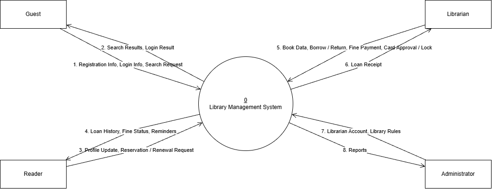

#### External Entities

| Entity | Description |
|---|---|
| Guest | Visitor who has not logged in. Registers, logs in, and searches books. |
| Reader | Library member. Reserves and renews books, views loans and fines. |
| Librarian | Staff member. Manages books and reader cards, handles borrowing, returning, and cash fine payments at the counter. |
| Administrator | Manages Librarian accounts, library rules, and reports. |

#### Data Flows

| No. | From | To | Data | Related FR |
|---|---|---|---|---|
| 1 | Guest | LMS | Registration Info, Login Info, Search Request | FR-GST-01, FR-GST-02, FR-GST-04 |
| 2 | LMS | Guest | Search Results, Login Result | FR-GST-02, FR-GST-04 |
| 3 | Reader | LMS | Profile Update, Reservation / Renewal Request | FR-RDR-02 to FR-RDR-05 |
| 4 | LMS | Reader | Loan History, Fine Status, Reminders | FR-RDR-06, FR-RDR-08, FR-SYS-02 |
| 5 | Librarian | LMS | Book Data, Borrow / Return, Fine Payment, Card Approval / Lock | FR-LIB-01 to FR-LIB-11, FR-LIB-13 |
| 6 | LMS | Librarian | Loan Receipt | FR-LIB-06, FR-LIB-07 |
| 7 | Administrator | LMS | Librarian Account, Library Rules | FR-ADM-01, FR-ADM-04 |
| 8 | LMS | Administrator | Reports | FR-ADM-05 |

### 3.3 Data Stores

| Store | Name | Content |
|---|---|---|
| D1 | Accounts | User accounts, roles, library cards, card status |
| D2 | Books | Book titles, physical copies, copy status |
| D3 | Loans & Reservations | Borrowing records, due dates, renewals, reservation queues |
| D4 | Fines | Violations, fine amounts, payment status |

### 3.4 Level 1 DFD

Process 0 is split into five processes. Each process uses the data store drawn below it.

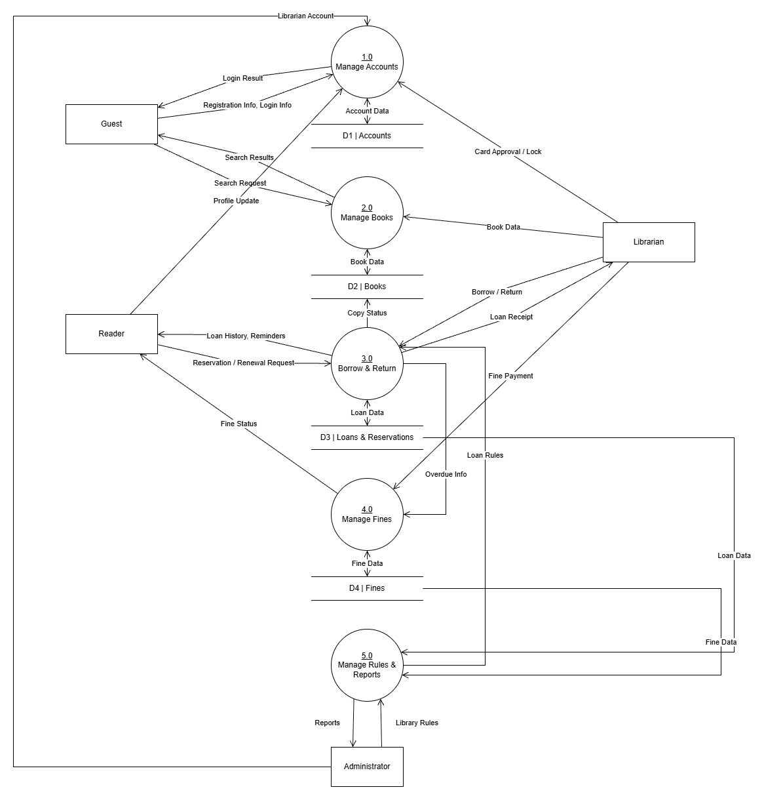

#### Process Descriptions

| Process | Inputs | Outputs | Data Stores | Related FR |
|---|---|---|---|---|
| 1.0 Manage Accounts | Registration Info, Login Info (Guest); Profile Update (Reader); Card Approval / Lock (Librarian); Librarian Account (Administrator) | Login Result (Guest) | D1 read/write | FR-GST-01, FR-GST-04, FR-RDR-02, FR-LIB-10, FR-LIB-11, FR-ADM-01 |
| 2.0 Manage Books | Search Request (Guest); Book Data (Librarian) | Search Results (Guest) | D2 read/write | FR-GST-02, FR-LIB-01 to FR-LIB-05 |
| 3.0 Borrow & Return | Reservation / Renewal Request (Reader); Borrow / Return (Librarian); Loan Rules (from 5.0) | Loan History, Reminders (Reader); Loan Receipt (Librarian); Overdue Info (to 4.0) | D3 read/write; D2 write (Copy Status) | FR-RDR-03 to FR-RDR-06, FR-LIB-06 to FR-LIB-08, FR-SYS-01 to FR-SYS-03 |
| 4.0 Manage Fines | Overdue Info (from 3.0); Fine Payment (Librarian) | Fine Status (Reader) | D4 read/write | FR-RDR-08, FR-LIB-09, FR-LIB-13 |
| 5.0 Manage Rules & Reports | Library Rules (Administrator); Loan Data (D3); Fine Data (D4) | Reports (Administrator); Loan Rules (to 3.0) | D3, D4 read | FR-ADM-04, FR-ADM-05 |

#### Balancing with Level 0

The flows between external entities and the system in Level 1 have the same names as in Level 0. Level 1 adds no new external flows. Account Data, Book Data, Loan Data, Copy Status, Fine Data, Overdue Info, and Loan Rules are internal flows.

#### Related Non-Functional Requirements

| Process | NFR | Constraint |
|---|---|---|
| 1.0 | NFR-SEC-01, NFR-SEC-05, NFR-SEC-06 | Passwords are hashed. Sessions end after 30 minutes of inactivity. An account is locked for 15 minutes after 5 failed logins. |
| 1.0 | NFR-SEC-03, NFR-SEC-04 | Access is role-based. A Reader can see only their own data. |
| 2.0 | NFR-PER-01 | Search results within 2 seconds. |
| 3.0 | NFR-PER-02, NFR-REL-02, NFR-REL-03 | A borrow or return is saved within 2 seconds after the scan. A failed transaction is rolled back. One copy cannot be lent to two Readers at once. |
| 3.0 | NFR-PER-04, NFR-REL-06 | The daily scan finishes within 30 minutes. Reminders are sent in the background. |
| 4.0 | NFR-REL-02, NFR-SEC-09 | A fine or cash payment is saved as one transaction. No card or bank details are stored. |
| 5.0 | NFR-MNT-02 | Library rules are changed on the Administrator screen without changing code. |
| All | NFR-SEC-02, NFR-SEC-07, NFR-USA-01, NFR-COM-03 | HTTPS for all traffic. Input is checked. The interface is in English (UTF-8), dates use DD/MM/YYYY, amounts are in VND. |

## 4. Use Case Diagram

### 4.1 Overview

The diagram covers the same functions as the DFDs in Section 3. The requirements left out in Section 3.1 are also left out of this diagram. Main use cases are linked to actors. Steps that several use cases share are drawn as `<<include>>` use cases, and optional steps that run only under a condition are drawn as `<<extend>>` use cases.

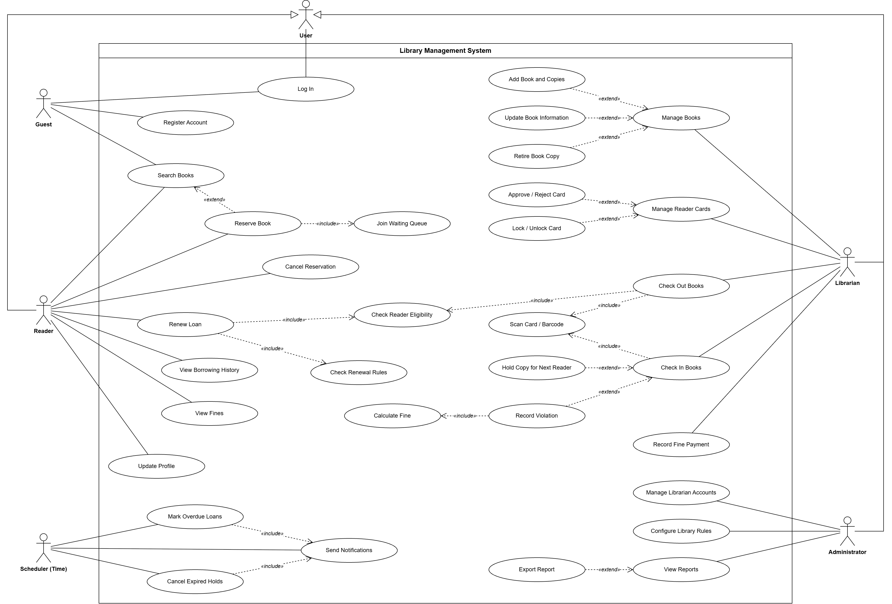

### 4.2 Actors

| Actor | Description |
|---|---|
| User | Parent actor for every account holder. Linked to Log In. |
| Guest | Visitor who has not logged in. Registers, logs in, and searches books (FR-GST-01, FR-GST-02, FR-GST-04). |
| Reader | Child of User. Library member (FR-RDR-01). |
| Librarian | Child of User. Library staff. |
| Administrator | Child of User. Manages staff accounts and library rules. |
| Scheduler (Time) | System clock that starts the daily automatic tasks at 00:00 (FR-SYS-01 to FR-SYS-03). It is not a person. |

Reader, Librarian, and Administrator get Log In from User through actor generalization, so the diagram does not link them to Log In one by one. After a Guest logs in, the system gives the user the Reader, Librarian, or Administrator role of that account (FR-GST-04).

### 4.3 Use Cases

| Actor | Use Case | Related FR |
|---|---|---|
| Guest | Register Account | FR-GST-01 |
| Guest, Reader | Search Books | FR-GST-02 |
| Guest, User | Log In | FR-GST-04 |
| Reader | Update Profile | FR-RDR-02 |
| Reader | Reserve Book | FR-RDR-03 |
| Reader | Cancel Reservation | FR-RDR-03 |
| Reader | Renew Loan | FR-RDR-04, FR-RDR-05 |
| Reader | View Borrowing History | FR-RDR-06 |
| Reader | View Fines | FR-RDR-08 |
| Librarian | Manage Books | FR-LIB-01 to FR-LIB-05 |
| Librarian | Manage Reader Cards | FR-LIB-10, FR-LIB-11 |
| Librarian | Check Out Books | FR-LIB-06, FR-LIB-07 |
| Librarian | Check In Books | FR-LIB-08 |
| Librarian | Record Fine Payment | FR-LIB-13 |
| Administrator | Manage Librarian Accounts | FR-ADM-01 |
| Administrator | Configure Library Rules | FR-ADM-04 |
| Administrator | View Reports | FR-ADM-05 |
| Scheduler (Time) | Mark Overdue Loans | FR-SYS-01 |
| Scheduler (Time) | Send Notifications | FR-SYS-02 |
| Scheduler (Time) | Cancel Expired Holds | FR-SYS-03 |

### 4.4 Include and Extend Use Cases

`<<include>>`: the base use case always runs the included use case. `<<extend>>`: the extending use case runs only when its condition is true. The arrow points from the base to the included use case, and from the extending use case to the base.

| Base Use Case | Type | Use Case | When / Meaning | Related FR |
|---|---|---|---|---|
| Reserve Book | `<<include>>` | Join Waiting Queue | The Reader is always added to the FIFO queue. | FR-RDR-03 |
| Renew Loan | `<<include>>` | Check Reader Eligibility | Card is active, no overdue books, no unpaid fines. | FR-RDR-05 |
| Renew Loan | `<<include>>` | Check Renewal Rules | Renewal limit not reached and nobody waiting in the queue. | FR-RDR-05 |
| Check Out Books | `<<include>>` | Check Reader Eligibility | Same check, plus the borrowing limit and copy status. | FR-LIB-07 |
| Check Out Books | `<<include>>` | Scan Card / Barcode | The card code and each copy barcode are scanned. | FR-LIB-06 |
| Check In Books | `<<include>>` | Scan Card / Barcode | The copy barcode is scanned. | FR-LIB-08 |
| Record Violation | `<<include>>` | Calculate Fine | Days late × daily fine rate, or the amount entered for a damaged or lost book. | FR-LIB-09 |
| Mark Overdue Loans | `<<include>>` | Send Notifications | Overdue notice to the Reader. | FR-SYS-01, FR-SYS-02 |
| Cancel Expired Holds | `<<include>>` | Send Notifications | Pickup notice to the next Reader in the queue. | FR-SYS-02, FR-SYS-03 |
| Search Books | `<<extend>>` | Reserve Book | Only when no copy of the book is available on the shelf. | FR-RDR-03 |
| Manage Books | `<<extend>>` | Add Book and Copies | When the Librarian adds a title and its copies. | FR-LIB-01, FR-LIB-03, FR-LIB-04 |
| Manage Books | `<<extend>>` | Update Book Information | When the Librarian edits a book or copy. | FR-LIB-02 to FR-LIB-04 |
| Manage Books | `<<extend>>` | Retire Book Copy | Only for a copy that is not on loan. | FR-LIB-05 |
| Manage Reader Cards | `<<extend>>` | Approve / Reject Card | When a new registration is pending. | FR-LIB-10 |
| Manage Reader Cards | `<<extend>>` | Lock / Unlock Card | When a Reader breaks the rules or the issue is resolved. | FR-LIB-11 |
| Check In Books | `<<extend>>` | Hold Copy for Next Reader | Only when another Reader is waiting in the queue. | FR-LIB-08 |
| Check In Books | `<<extend>>` | Record Violation | Only when the book is late, damaged, or lost. | FR-LIB-09 |
| View Reports | `<<extend>>` | Export Report | When the Administrator chooses to export. | FR-ADM-05 |

Other relationships: Reader, Librarian, and Administrator are linked to User by generalization; each actor is linked to its use cases by association.

### 4.5 Related Non-Functional Requirements

| Use Case | NFR | Constraint |
|---|---|---|
| Log In | NFR-SEC-01, NFR-SEC-05, NFR-SEC-06 | Hashed passwords, 30-minute session timeout, 15-minute lock after 5 failed attempts |
| Search Books | NFR-PER-01 | Results within 2 seconds |
| View Borrowing History, View Fines | NFR-SEC-04 | A Reader sees only their own data |
| Check Out Books, Check In Books | NFR-PER-02, NFR-REL-02, NFR-REL-03 | Saved within 2 seconds after the scan; rollback on failure; no double loan of one copy |
| Mark Overdue Loans, Send Notifications, Cancel Expired Holds | NFR-PER-04, NFR-REL-06 | The daily scan finishes within 30 minutes; notifications are sent in the background |
| Configure Library Rules | NFR-MNT-02, NFR-USA-05 | Rules are changed without changing code; a confirmation is asked before saving |
| All | NFR-SEC-03 | Each role can use only its own use cases |

## 5. Class Diagram

### 5.1 Overview

This section lists the main classes of the Library Management System (LMS) along with their attributes, methods, and relationships.

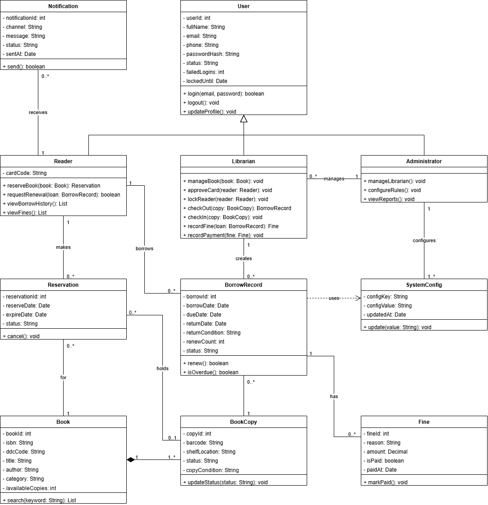

### 5.2 Class Descriptions

| Class | Description | DFD Store | Related FR |
|---|---|---|---|
| `User` | Base class for all accounts (`userId`, `fullName`, `email`, `phone`, `passwordHash`, `status`, `failedLogins`, `lockedUntil`) with login, logout, and profile update methods. | D1 | FR-GST-01, FR-GST-04, FR-RDR-02 |
| `Reader` | Inherits from `User`. Adds `cardCode` and methods for reserving books, requesting renewals, and viewing borrowing history and fines. | D1 | FR-RDR-01 to FR-RDR-06, FR-RDR-08 |
| `Librarian` | Inherits from `User`. Provides methods to manage books, approve or lock reader cards, check out and check in books, and record fines and cash payments. | D1 | FR-LIB-01 to FR-LIB-11, FR-LIB-13 |
| `Administrator` | Inherits from `User`. Provides methods to manage librarian accounts, configure library rules, and view reports. | D1 | FR-ADM-01, FR-ADM-04, FR-ADM-05 |
| `Book` | Contains book information (`bookId`, `isbn`, `ddcCode`, `title`, `author`, `category`, `availableCopies`) and search method. | D2 | FR-GST-02, FR-LIB-01 to FR-LIB-03 |
| `BookCopy` | A physical copy of a book on the shelf (`copyId`, `barcode`, `shelfLocation`, `status`, `condition`). | D2 | FR-LIB-04, FR-LIB-05, FR-LIB-08 |
| `BorrowRecord` | Records a borrowing transaction (`borrowId`, `borrowDate`, `dueDate`, `returnDate`, `returnCondition`, `renewCount`, `status`). | D3 | FR-RDR-04 to FR-RDR-06, FR-LIB-06 to FR-LIB-09, FR-SYS-01 |
| `Reservation` | Keeps track of online book holds and waiting queues (`reservationId`, `reserveDate`, `expireDate`, `status`). | D3 | FR-RDR-03, FR-SYS-03 |
| `Notification` | Stores reminder messages (`notificationId`, `channel`, `message`, `status`, `sentAt`) sent to Readers. | D3 | FR-SYS-02 |
| `Fine` | Records a reader violation and its cash payment status (`fineId`, `reason`, `amount`, `isPaid`, `paidAt`). | D4 | FR-RDR-08, FR-LIB-09, FR-LIB-13 |
| `SystemConfig` | Stores library settings (`configKey`, `configValue`, `updatedAt`) such as borrowing limits, loan days, renewal limits, hold days, and the daily fine rate. | Internal | FR-ADM-04 |

### 5.3 Relationships

| Relationship | Type | Multiplicity | Meaning |
|---|---|---|---|
| Reader, Librarian, Administrator -> User | Generalization | - | Each role is a kind of User and shares login data. |
| Administrator - Librarian (manages) | Association | 1 : 0..* | One Administrator manages many Librarian accounts. |
| Administrator - SystemConfig (configures) | Association | 1 : 1..* | The Administrator sets the library rules. |
| Reader - Notification (receives) | Association | 1 : 0..* | A Reader can receive many reminders. |
| Reader - Reservation (makes) | Association | 1 : 0..* | A Reader can make many reservations. |
| Book - Reservation (for) | Association | 1 : 0..* | A reservation is for a book title; one title can have a queue. |
| Reservation - BookCopy (holds) | Association | 0..1 : 0..1 | When a copy comes back, it is held for one reservation. |
| Reader - BorrowRecord (borrows) | Association | 1 : 0..* | A Reader can have many loans. |
| Librarian - BorrowRecord (creates) | Association | 1 : 0..* | Each loan is created by one Librarian at the counter. |
| BookCopy - BorrowRecord | Association | 1 : 0..* | A copy is lent many times over time; each loan is for one copy. |
| Book - BookCopy | Composition | 1 : 1..* | A copy is part of a title and does not exist without it. |
| BorrowRecord - Fine (has) | Association | 1 : 0..* | A loan can have no fine or several fines. |
| BorrowRecord -> SystemConfig (uses) | Dependency | - | A loan reads the loan period and fine rate when it is created or closed. |

## 6. Data Model

### 6.1 Overview

The database uses UTF-8 (`utf8mb4`) encoding (`NFR-USA-01`, `NFR-COM-03`) and consists of 8 relational tables in Third Normal Form (3NF). The tables match the classes in Section 5 and the four data stores (`D1` to `D4`) in Section 3.3. The inheritance hierarchy of `User` (`Reader`, `Librarian`, `Administrator`) is mapped into a single `users` table using a `role` column.

### 6.2 Entity-Relationship Diagram (ERD)

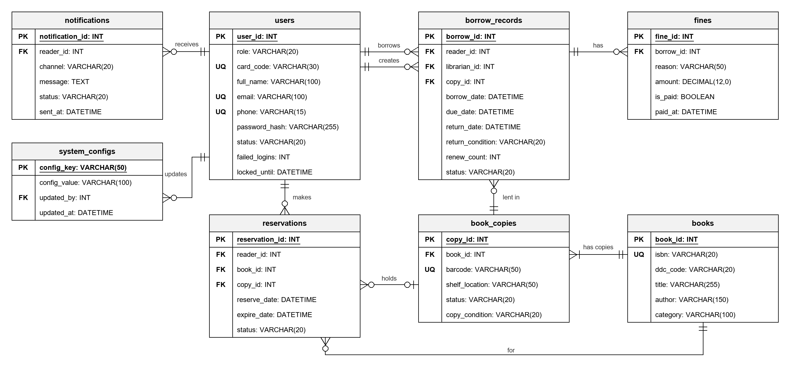

### 6.3 Mapping to DFD Data Stores

| DFD Store | Store Name | Mapped Database Tables |
|---|---|---|
| **D1** | Accounts | `users` |
| **D2** | Books | `books`, `book_copies` |
| **D3** | Loans & Reservations | `borrow_records`, `reservations`, `notifications` |
| **D4** | Fines | `fines` |
| **Internal** | Process 5.0 Rules | `system_configs` |

### 6.4 Data Dictionary (Table Specifications)

#### 1. `users` (Store D1)
Stores accounts for Readers, Librarians, and Administrators (`FR-GST-01`, `FR-GST-04`, `FR-RDR-02`, `FR-LIB-10`, `FR-LIB-11`, `FR-ADM-01`).

| Column Name | Data Type | Constraints & Keys | Description |
|---|---|---|---|
| `user_id` | INT | PK, AUTO_INCREMENT | Unique user identifier |
| `role` | VARCHAR(20) | NOT NULL | Account role: `READER`, `LIBRARIAN`, `ADMIN` |
| `card_code` | VARCHAR(30) | UNIQUE, NULL | Library card barcode (for Readers only) |
| `full_name` | VARCHAR(100) | NOT NULL | Full name of the user |
| `email` | VARCHAR(100) | UNIQUE, NOT NULL | Unique email address |
| `phone` | VARCHAR(15) | UNIQUE, NOT NULL | Unique phone number |
| `password_hash` | VARCHAR(255) | NOT NULL | Salted Bcrypt password hash (`NFR-SEC-01`) |
| `status` | VARCHAR(20) | NOT NULL, DEFAULT 'PENDING' | Account status: `PENDING`, `ACTIVE`, `LOCKED`, `REJECTED` |
| `failed_logins` | INT | NOT NULL, DEFAULT 0 | Consecutive failed login attempts (`NFR-SEC-06`) |
| `locked_until` | DATETIME | NULL | End time of temporary login lock (`NFR-SEC-06`) |

#### 2. `books` (Store D2)
Stores book title metadata (`FR-GST-02`, `FR-LIB-01` to `FR-LIB-03`).

| Column Name | Data Type | Constraints & Keys | Description |
|---|---|---|---|
| `book_id` | INT | PK, AUTO_INCREMENT | Unique book identifier |
| `isbn` | VARCHAR(20) | UNIQUE, NOT NULL | Standard ISBN code |
| `ddc_code` | VARCHAR(20) | NOT NULL | Dewey Decimal Classification code |
| `title` | VARCHAR(255) | NOT NULL | Book title |
| `author` | VARCHAR(150) | NOT NULL | Author name |
| `category` | VARCHAR(100) | NOT NULL | Book category |
| `available_copies` | INT | NOT NULL, DEFAULT 0 | Number of copies with status `AVAILABLE`; recalculated in the same transaction whenever a copy's status changes (`NFR-REL-02`) |

#### 3. `book_copies` (Store D2)
Stores physical book copies for barcode scanning (`FR-LIB-01`, `FR-LIB-04`, `FR-LIB-05`, `FR-LIB-08`).

| Column Name | Data Type | Constraints & Keys | Description |
|---|---|---|---|
| `copy_id` | INT | PK, AUTO_INCREMENT | Unique physical copy identifier |
| `book_id` | INT | FK (`books.book_id`), NOT NULL | Reference to the book title |
| `barcode` | VARCHAR(50) | UNIQUE, NOT NULL | Barcode label on the physical copy |
| `shelf_location` | VARCHAR(50) | NOT NULL | Shelf location in the storage |
| `status` | VARCHAR(20) | NOT NULL, DEFAULT 'AVAILABLE' | `AVAILABLE`, `BORROWED`, `RESERVED` (on hold for a Reader), `CANCELED` (retired, damaged, or lost) |
| `condition` | VARCHAR(20) | NOT NULL, DEFAULT 'INTACT' | Physical state: `INTACT`, `DAMAGED`, `LOST` |

#### 4. `borrow_records` (Store D3)
Stores counter borrowing, returning, and loan renewal records (`FR-RDR-04` to `FR-RDR-06`, `FR-LIB-06` to `FR-LIB-09`, `FR-SYS-01`).

| Column Name | Data Type | Constraints & Keys | Description |
|---|---|---|---|
| `borrow_id` | INT | PK, AUTO_INCREMENT | Unique borrowing transaction identifier |
| `reader_id` | INT | FK (`users.user_id`), NOT NULL | Reader who borrowed the book |
| `copy_id` | INT | FK (`book_copies.copy_id`), NOT NULL | Borrowed physical book copy |
| `librarian_id` | INT | FK (`users.user_id`), NOT NULL | Librarian who created the transaction |
| `borrow_date` | DATETIME | NOT NULL | Date and time of checkout |
| `due_date` | DATETIME | NOT NULL | Borrow date plus `MAX_DAYS`; extended by `MAX_DAYS` on each renewal |
| `return_date` | DATETIME | NULL | Actual return date (`NULL` if not yet returned) |
| `return_condition` | VARCHAR(20) | NULL | Recorded condition upon return (`INTACT`, `DAMAGED`, `LOST`) |
| `renew_count` | INT | NOT NULL, DEFAULT 0 | Number of renewals; cannot exceed `MAX_RENEW` |
| `status` | VARCHAR(20) | NOT NULL, DEFAULT 'BORROWED' | `BORROWED`, `OVERDUE`, `RETURNED` |

#### 5. `reservations` (Store D3)
Stores online book reservations and waiting queues (`FR-RDR-03`, `FR-LIB-08`, `FR-SYS-03`).

| Column Name | Data Type | Constraints & Keys | Description |
|---|---|---|---|
| `reservation_id` | INT | PK, AUTO_INCREMENT | Unique reservation identifier |
| `reader_id` | INT | FK (`users.user_id`), NOT NULL | Reader who placed the reservation |
| `book_id` | INT | FK (`books.book_id`), NOT NULL | Reserved book title |
| `copy_id` | INT | FK (`book_copies.copy_id`), NULL | Specific copy held on the waiting shelf when returned |
| `reserve_date` | DATETIME | NOT NULL | Date and time the reservation was made (sets the FIFO order) |
| `expire_date` | DATETIME | NULL | Pickup deadline: hold start plus `HOLD_DAYS` |
| `status` | VARCHAR(20) | NOT NULL, DEFAULT 'WAITING' | `WAITING`, `READY`, `COMPLETED`, `CANCELED` |

#### 6. `fines` (Store D4)
Stores violation records and cash fine payments at the counter (`FR-RDR-08`, `FR-LIB-09`, `FR-LIB-13`).

| Column Name | Data Type | Constraints & Keys | Description |
|---|---|---|---|
| `fine_id` | INT | PK, AUTO_INCREMENT | Unique fine identifier |
| `borrow_id` | INT | FK (`borrow_records.borrow_id`), NOT NULL | Related borrowing record |
| `reason` | VARCHAR(50) | NOT NULL | Violation reason: `LATE_RETURN`, `DAMAGED`, `LOST` |
| `amount` | DECIMAL(10,2) | NOT NULL | Fine amount in VND (`NFR-COM-03`) |
| `is_paid` | BOOLEAN | NOT NULL, DEFAULT FALSE | Payment status (`TRUE` if paid, `FALSE` if unpaid) |
| `paid_at` | DATETIME | NULL | Date and time when the fine was paid in cash at the counter |

#### 7. `system_configs` (Process 5.0 Rules)
Stores library parameters configured by the Administrator (`FR-ADM-04`, `NFR-MNT-02`).

| Column Name | Data Type | Constraints & Keys | Description |
|---|---|---|---|
| `config_key` | VARCHAR(50) | PK | Rule key: `MAX_BOOKS`, `MAX_DAYS`, `MAX_RENEW`, `HOLD_DAYS`, `DAILY_FINE` |
| `config_value` | VARCHAR(100) | NOT NULL | Configured parameter value |
| `updated_by` | INT | FK (`users.user_id`), NOT NULL | Administrator who last updated the rule |
| `updated_at` | DATETIME | NOT NULL | Timestamp of the last update |

#### 8. `notifications` (Store D3 Reminders)
Stores automated due, overdue, and pickup reminders sent to Readers (`FR-SYS-02`, `NFR-REL-06`).

| Column Name | Data Type | Constraints & Keys | Description |
|---|---|---|---|
| `notification_id` | INT | PK, AUTO_INCREMENT | Unique notification identifier |
| `reader_id` | INT | FK (`users.user_id`), NOT NULL | Recipient Reader |
| `channel` | VARCHAR(20) | NOT NULL | Delivery channel (`IN_APP` in this version) |
| `message` | TEXT | NOT NULL | Reminder message content |
| `status` | VARCHAR(20) | NOT NULL, DEFAULT 'PENDING' | Delivery status: `PENDING`, `SENT`, `FAILED` |
| `sent_at` | DATETIME | NULL | Timestamp when the notification was sent |

### 6.5 Status Changes for Borrowing and Returning

Each event below runs as one transaction (`NFR-REL-02`). The checks come from Section 1. Whenever a copy's status changes, `books.available_copies` is recalculated.

| Event | Check before saving | Table changes |
|---|---|---|
| Check out (FR-LIB-06, FR-LIB-07) | Card `ACTIVE`; no `OVERDUE` loan; no unpaid fine; loans below `MAX_BOOKS`; copy `AVAILABLE`, or `RESERVED` for this Reader | New `borrow_records` row (`BORROWED`, `due_date` = now + `MAX_DAYS`); copy → `BORROWED`; the Reader's `READY` reservation → `COMPLETED` |
| Renew (FR-RDR-04, FR-RDR-05) | Card `ACTIVE`; no `OVERDUE` loan; no unpaid fine; `renew_count` < `MAX_RENEW`; no `WAITING` reservation for the book | `due_date` + `MAX_DAYS`; `renew_count` + 1 |
| Reserve (FR-RDR-03) | Card `ACTIVE`; no copy of the book is `AVAILABLE`; at least one copy is not `CANCELED` | New `reservations` row (`WAITING`) |
| Daily scan 00:00 (FR-SYS-01, FR-SYS-02) | `BORROWED` loan with `due_date` < today, or due in 2 days | Past due: loan → `OVERDUE` and overdue reminder. Due in 2 days: due-soon reminder |
| Return, intact (FR-LIB-08) | Copy is `BORROWED` | `return_date`, `return_condition` = `INTACT`, loan → `RETURNED`. If a reservation is `WAITING`: copy → `RESERVED`, first reservation → `READY` with `copy_id` and `expire_date` = now + `HOLD_DAYS`, pickup reminder. Otherwise copy → `AVAILABLE` |
| Return, damaged or lost (FR-LIB-08, FR-LIB-09) | Copy is `BORROWED` | Loan → `RETURNED`; copy `condition` updated, status → `CANCELED`; new `fines` row (`DAMAGED` or `LOST`, amount entered by the Librarian) |
| Return late (FR-LIB-09) | `return_date` > `due_date` | New `fines` row (`LATE_RETURN`, amount = days late × `DAILY_FINE`). If the book is also damaged or lost, the row above adds a second fine |
| Cash payment (FR-LIB-13) | Fine `is_paid` = `FALSE` | `is_paid` = `TRUE`, `paid_at` = now |
| Hold expires (FR-SYS-03) | `READY` reservation with `expire_date` < now | Reservation → `CANCELED`. Next `WAITING` reservation → `READY` with a new `expire_date`, or copy → `AVAILABLE` |

## 7. Interface Design Description

### 7.1 Guest

#### 7.1.1 Home
This interface shows the book categories, library news, and new books (FR-GST-03).

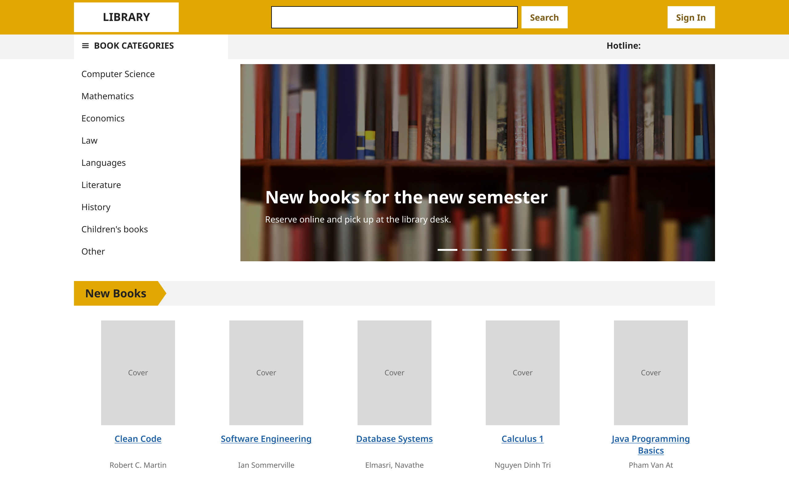

#### 7.1.2 Search Books
This interface shows the books that match a keyword or category and whether each book is available (FR-GST-02).

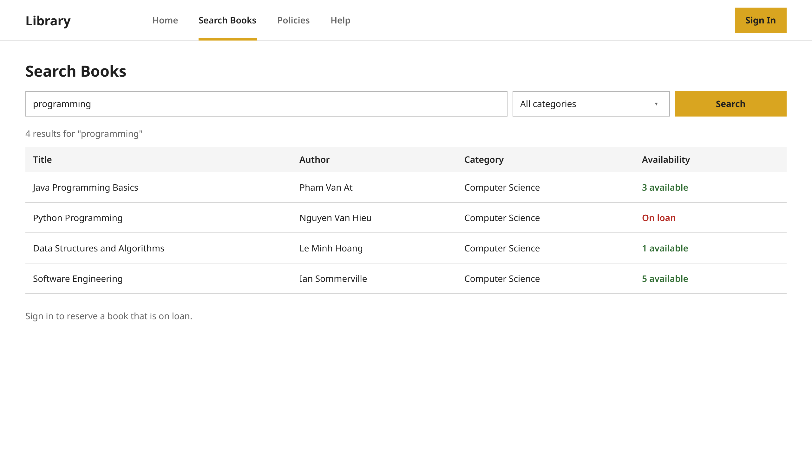

#### 7.1.3 Loading
This interface is shown while search results are loading (NFR-PER-01).

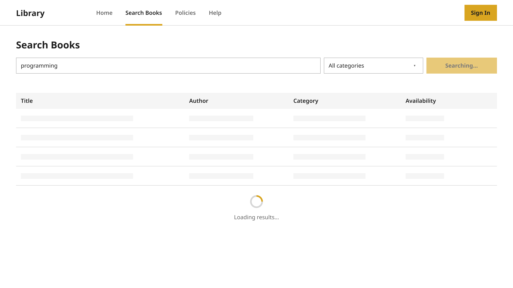

#### 7.1.4 Library Policies
This interface shows the library rules on membership, borrowing, reservations, and fines (FR-GST-03).

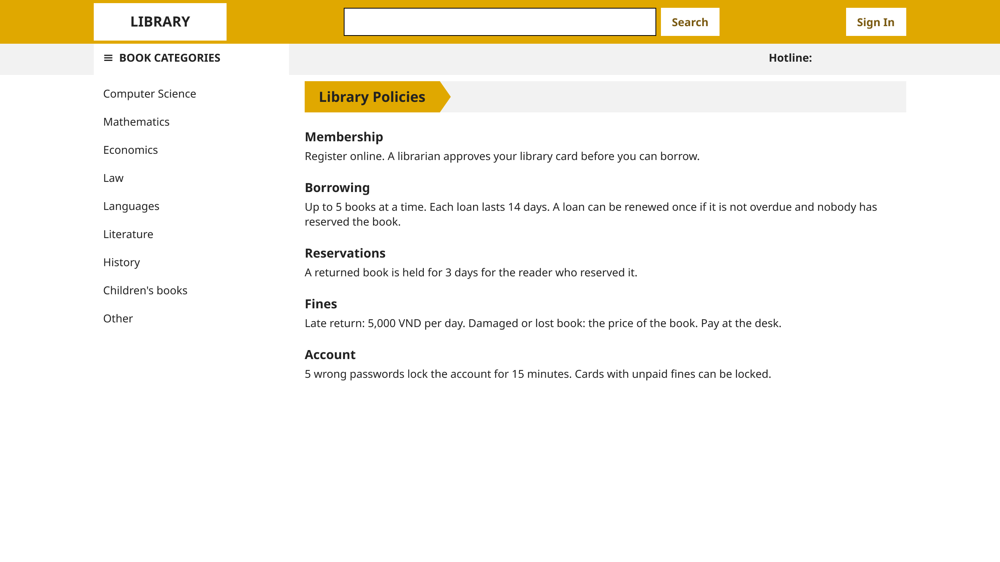

#### 7.1.5 Help
This interface explains how to borrow a book and answers common questions (FR-GST-03).

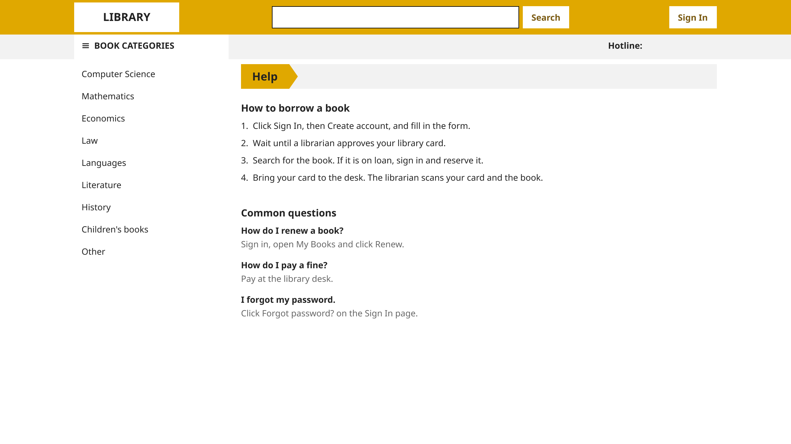

#### 7.1.6 Page Not Found
This interface is shown when a page does not exist.

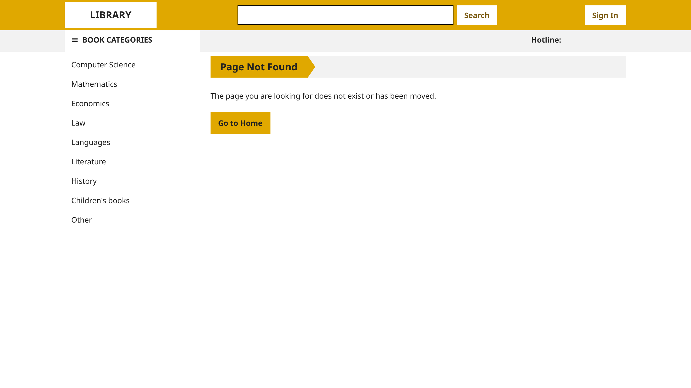

#### 7.1.7 Sign In
This interface allows users to log in with email and password (FR-GST-04). A Guest who has forgotten their password may request a reset from an Administrator (FR-GST-05).

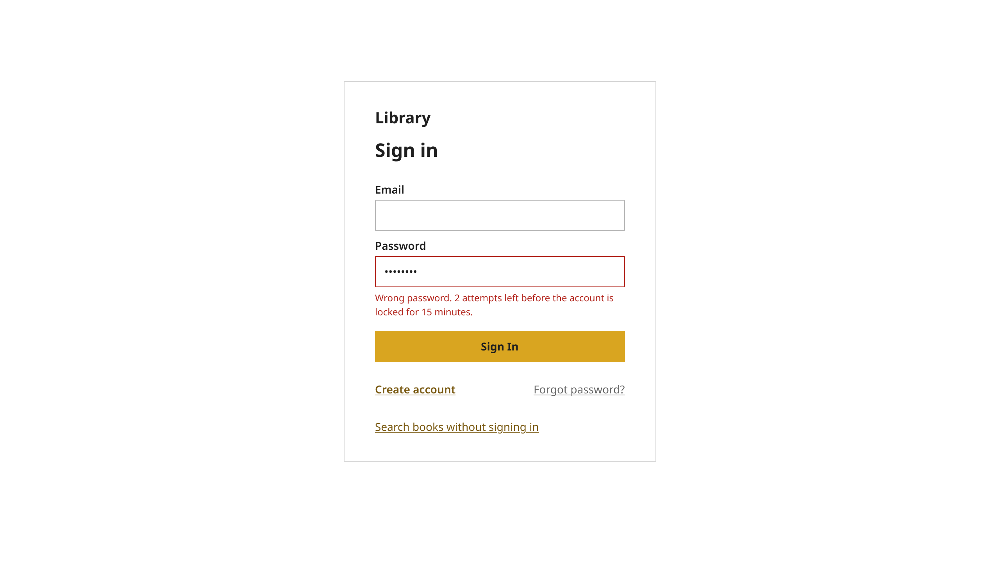

#### 7.1.8 Create Account
This interface allows Guests to register for a library card (FR-GST-01).

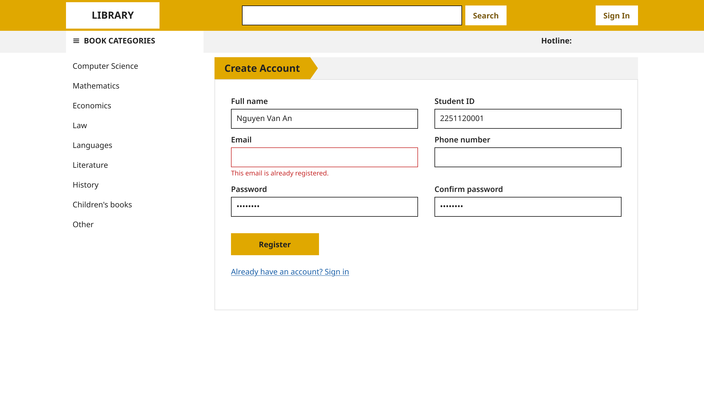

### 7.2 Reader

#### 7.2.1 My Books
This interface allows Readers to view current loans, renew books, and view fines to pay at the counter (FR-RDR-04 to FR-RDR-06, FR-RDR-08).

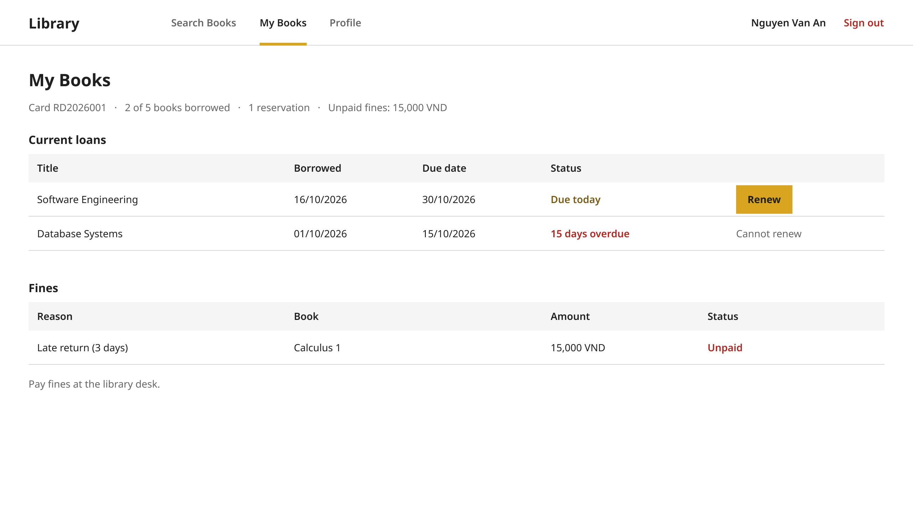

### 7.3 Librarian

#### 7.3.1 Check Out
This interface allows Librarians to lend books by scanning the reader card and book barcodes (FR-LIB-06, FR-LIB-07).

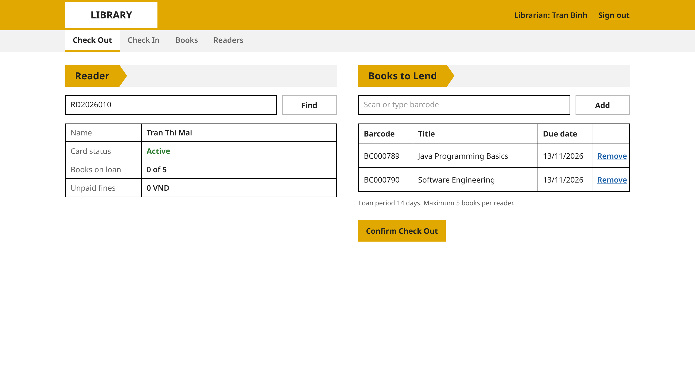

#### 7.3.2 Check In
This interface allows Librarians to record returned books, their condition, and fines (FR-LIB-08, FR-LIB-09).

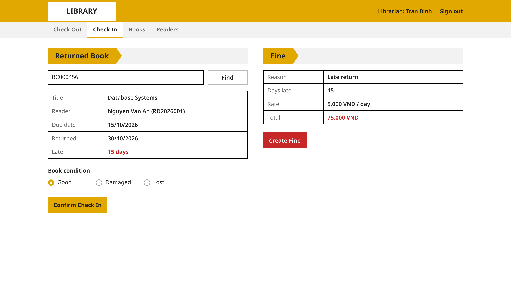

#### 7.3.3 Books
This interface allows Librarians to add, edit, and retire books (FR-LIB-01 to FR-LIB-05).

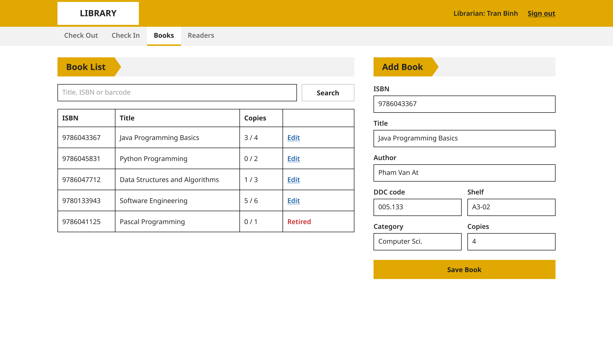

#### 7.3.4 Readers
This interface allows Librarians to approve, lock, or unlock reader cards and record cash fine payments (FR-LIB-10, FR-LIB-11, FR-LIB-13).

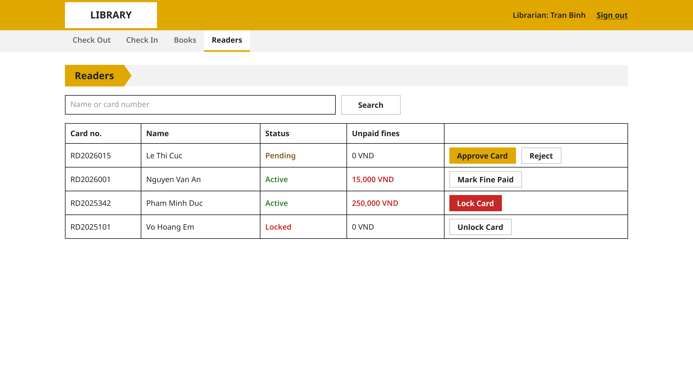

### 7.4 Administrator

#### 7.4.1 Librarian Accounts
This interface allows Administrators to add, edit, and lock librarian accounts (FR-ADM-01).

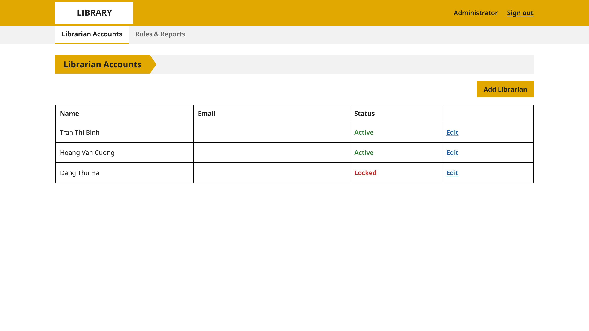

#### 7.4.2 Rules and Reports
This interface allows Administrators to configure library rules and view reports (FR-ADM-04, FR-ADM-05).

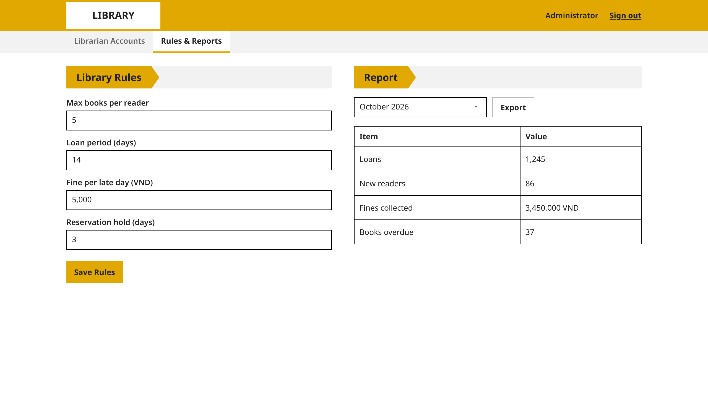
